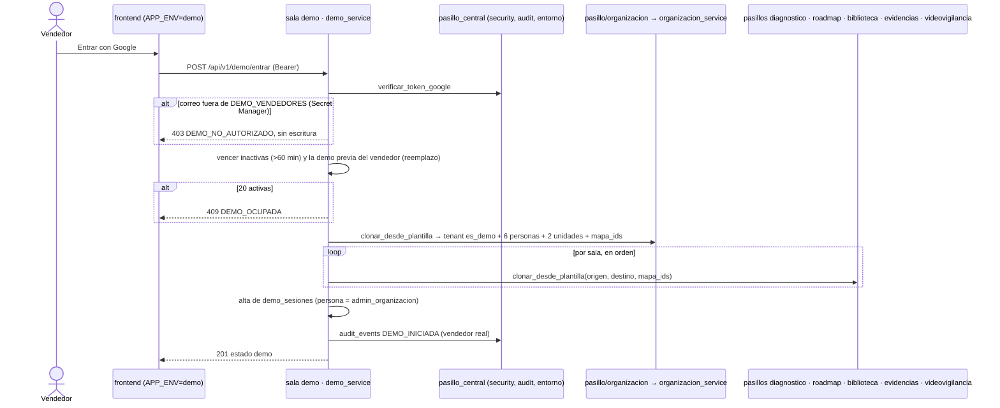
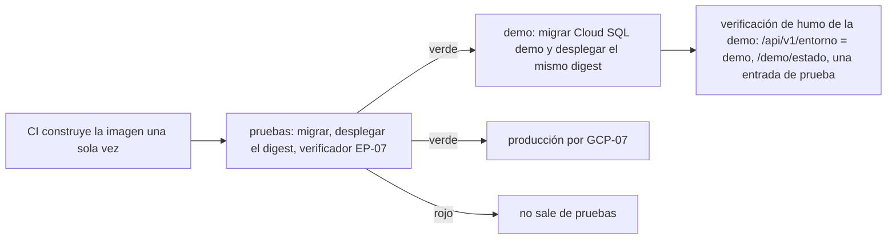

# EVYDENTIA · Demo comercial en Google Cloud: flujos, corte ortogonal y dependencias

Arquitecto de soluciones ADPA · 2026-11-07
Fuentes (PR #435, rama `tarea/juan-carlos/prd-evydentia-demo`): PRD §5.1, §5.2, §5.5 y §5.6.1–5.6.8; INVARIANTS §8 (60–63); `app_core/pasillo/*` y ADR 0001. Antecedentes: `governance/apoyo/FLUJOS_DEMO_COMERCIAL.md`, `UX_DEMO_COMERCIAL.md` y la matriz del PMV.

Leyes que rigen el corte (PRD §5.1): (3) una sala solo llama a otra por `app_core/pasillo/<B>.py` → `features/<B>/<B>_service.py`; (4) compuertas, pasillos, catálogos de errores y registros de vistas se reparten por secciones `# --- INICIO <ID> --- … # --- FIN <ID> ---`. Por eso, en esta matriz, «compartir» un archivo significa que cada ficha escribe solo su propia sección.

---

## 0. Tres hallazgos que cambian el corte del §5.6.8

**H1. Clonar la plantilla abarca seis salas, no una.** El §5.6.1.4 pide en la plantilla estructura orgánica, diagnóstico a medio revisar, hallazgos y tareas, documentos de Biblioteca, evidencias en la Bóveda y clips de videovigilancia. Esos datos pertenecen a `organizacion`, `diagnostico`, `roadmap`, `biblioteca`, `evidencias`/`boveda_cloud` y `videovigilancia`. Si DEMO-03, desde `organizacion`, los copiara todos, violaría la ley 3. Propuesta:
- cada sala con datos en la plantilla expone en su compuerta y en su pasillo una sección `clonar_desde_plantilla(session, origen, destino, mapa_ids)` (ficha **DEMO-03x** por sala);
- el orquestador de la copia vive en la sala `demo` (DEMO-02) y llama a cada pasillo en orden: organización primero, porque produce el mapa de personas y unidades que necesitan las demás;
- la siembra de la plantilla (datos ficticios) es de `operaciones` (DEMO-03, reutilizando el sembrador de EP-03).

Además, `boveda_cloud` y `videovigilancia` **aún no existen** en el código (`features/` de la rama). Las secciones DEMO-03e y DEMO-03f dependen de que existan esas salas. Hasta entonces la plantilla sale sin clips y con evidencias solo como registro.

**H2. DEMO-01 tocaba dos salas.** El resolutor tiene una parte en `pasillo_central` (el gancho dentro de `usuario_verificado` y su registro, que falla fuera de `APP_ENV=demo`) y otra en la sala `demo` (resolver la persona y «Ver como»). Con la regla de «una ficha, una sala dueña», se parte en dos:
- **DEMO-08 · Gancho de identidad** (sala `pasillo_central`): dueña única de `app_core/security.py` para la demo;
- **DEMO-01 · Persona activa y «Ver como»** (sala `demo`).

La barrera contra producción **ya no es de la demo**: es de EP-01 (`APP_ENV=demo` con `HUELLA_PROYECTO_PRODUCCION`). Ni DEMO-08 ni DEMO-01 tocan `exigir_arranque_seguro()`.

**H3. El texto de la franja por entorno lo tiene que traer EP-02.** Si DEMO-04 editara el componente de EP-02 para añadir el texto «Demostración · datos ficticios», habría dos dueños del mismo archivo. Pido que EP-02 incluya desde su ficha la entrada `demo` en su mapa de textos por entorno (el texto ya está en el §5.6.1.6). Así DEMO-04 solo la lee.

---

## 1. Flujos

### 1.1 Entrada



Toda la copia ocurre en una sola transacción de base de datos. La copia de objetos en los buckets (servidor a servidor, con un prefijo por `tenant_id`) se hace antes del commit, y si algo falla, lo ya copiado queda huérfano hasta que lo borra la purga (red de seguridad: el ciclo de vida corto de los buckets, §5.6.2). El tope y el alta van con un bloqueo (`pg_advisory_xact_lock`).

### 1.2 «Ver como» (seis personas)

Es igual que en el PMV, con seis personas: `admin_organizacion`, `coordinador`, `implementador`, `dpo`, `responsable_area` (responde a una de las dos unidades) y `auditor`. `POST /api/v1/demo/persona` → 403 `DEMO_PERSONA_AJENA` si la persona no está en el tenant `es_demo` de la sesión. `audit_events` registra `DEMO_CAMBIO_PERSONA` con el vendedor real, la persona y la hora (invariante 61).

### 1.3 Cada petición

El token se verifica; después el gancho de DEMO-08 llama al resolutor registrado (DEMO-01), que traduce el `sub` a la persona activa. Si la sesión venció (60 min, terminada o reemplazada) → 401 `DEMO_VENCIDA`. La actividad se renueva como mucho cada 60 s. RBAC, RLS y SoD no cambian.

### 1.4 Vencimiento y «Terminar demo»

`POST /api/v1/demo/terminar` → estado `vencida`, motivo `terminar`; evento de auditoría; el frontend cierra la sesión. El aviso que se muestra es «La demo se cerró y sus datos se eliminan esta noche». La aplicación nunca borra (invariante 63).

### 1.5 Purga nocturna

```mermaid
sequenceDiagram
    participant CS as Cloud Scheduler (proyecto demo)
    participant J as Cloud Run Job purga-demo (SA propia)
    participant SM as Secret Manager
    participant SQL as Cloud SQL demo
    participant GCS as Buckets demo
    CS->>J: ejecución nocturna
    J->>J: se niega si el proyecto no es el de la demo o coincide con HUELLA_PROYECTO_PRODUCCION
    J->>SM: credencial del rol de purga (solo la lee esta SA)
    J->>SQL: tenants es_demo vencidos, excepto la plantilla
    J->>GCS: borra los objetos con prefijo tenant_id en cada bucket
    J->>SQL: borra las filas de todas las tablas con tenant_id (auditoría incluida), personas y tenant
    J->>SQL: comprueba que quedan 0 filas; si no, el job sale con error
```

Primero los objetos y después las filas: si el job se corta a mitad, la siguiente noche lo reintenta, porque el tenant sigue figurando como vencido.

### 1.6 Despliegue por digest



Lo ejecutan personas (Juan Carlos, Aleczandra o José), nunca una sesión de IA. Sembrar o actualizar la plantilla es un paso manual aparte, tras una migración que la afecte.

### 1.7 Errores

| Caso | HTTP / código | Texto |
|---|---|---|
| Correo no autorizado | 403 `DEMO_NO_AUTORIZADO` | «No autorizado para la demo» |
| Demo ocupada | 409 `DEMO_OCUPADA` | «Demo ocupada, intenta en unos minutos» |
| Demo vencida | 401 `DEMO_VENCIDA` | «Tu demostración terminó» |
| Persona ajena | 403 `DEMO_PERSONA_AJENA` | «Esa persona no pertenece a tu demostración» |
| Fuera de `APP_ENV=demo` | 404 en `/demo/*` | — |
| Falla la copia de la plantilla | 503 `DEMO_NO_DISPONIBLE` (nuevo) | «No pudimos preparar la demo; intenta de nuevo» |

---

## 2. Fichas: una sala dueña por ficha

| Ficha | Sala dueña | Entrega |
|---|---|---|
| DEMO-00 · Contrato | `demo` | `demo_service.py` con todas las firmas, `domain/` (sesión, errores, eventos, `TOPE=20`, 60 min), `repo/sesiones_repo.py`, `app_core/pasillo/demo.py` y la migración `demo_sesiones` + `tenants.es_demo`. Además fija por escrito la firma `clonar_desde_plantilla` que tendrán las demás salas |
| DEMO-08 · Gancho de identidad (nueva) | `pasillo_central` | Sección DEMO-08 en `app_core/security.py`: `registrar_resolutor_identidad` (lanza error si `APP_ENV≠demo`) y la llamada al resolutor en `usuario_verificado` |
| DEMO-01 · Persona activa y «Ver como» | `demo` | `services/resolutor_engine.py`, `services/persona_engine.py` y `api/routers/demo_persona.py` (registra el resolutor al importarse) |
| DEMO-02 · Ciclo de sesión | `demo` | `domain/vendedores.py`, `services/entrada_engine.py` (incluye el orquestador de la copia), `services/cierre_engine.py` y `api/routers/demo_sesion.py` |
| DEMO-03 · Siembra de la plantilla | `operaciones` | `scripts/demo/sembrar_plantilla.py` y los datos ficticios de «Cooperativa Demo» (6 personas `.invalid`, 2 unidades, estados del ciclo) |
| DEMO-03a · Clonar organización | `organizacion` | `services/clon_plantilla_engine.py` + secciones DEMO-03a en `organizacion_service.py` y `app_core/pasillo/organizacion.py` |
| DEMO-03b · Clonar diagnóstico | `diagnostico` | motor propio + secciones en su compuerta y su pasillo |
| DEMO-03c · Clonar hoja de ruta | `roadmap` | ídem |
| DEMO-03d · Clonar biblioteca | `biblioteca` | ídem |
| DEMO-03e · Clonar evidencias y objetos | `evidencias` (o `boveda_cloud` cuando exista) | ídem, con copia de objetos servidor a servidor |
| DEMO-03f · Clonar clips | `videovigilancia` | ídem; **bloqueada** hasta que exista la sala |
| DEMO-04 · Interfaz demo | `frontend` | componentes y cliente `demo`, selector con 6 personas, «Terminar demo», pantallas de error; monta la franja de EP-02 y no la edita |
| DEMO-05 · Purga | `operaciones` | `jobs/purga_demo/` (código del job y su Dockerfile), `tests/test_demo_purga.py` |
| DEMO-06 · Sin correos | `pruebas` | solo `tests/test_demo_sin_correos.py` (con `APP_ENV=demo` y la lista vacía no sale nada). La lógica es de EP-08 |
| DEMO-07 · Infraestructura (sin agente) | `operaciones` | `governance/operaciones/entornos/demo/*`, `governance/operaciones/DEMO_COMERCIAL.md`, OAuth, Scheduler, SA de purga, IAP si se decide |

## 3. Matriz flujo × archivo

E = dueño (crea o edita) · S = escribe solo su propia sección `#ID` (ley 4) · L = solo lee o importa · vacío = no lo toca

| Archivo | 00 | 08 | 01 | 02 | 03 | 03a–f | 04 | 05 | 06 | 07 |
|---|---|---|---|---|---|---|---|---|---|---|
| `features/demo/demo_service.py`, `domain/*`, `repo/sesiones_repo.py` | E | | L | L | | | | | | |
| `app_core/pasillo/demo.py` | E | | | | | | | | | |
| migración `demo_sesiones` / `es_demo` | E | | | | | | | L | | |
| `app_core/security.py` | | S | L | L | | | | | | |
| `features/demo/services/resolutor_engine.py`, `persona_engine.py`, `api/routers/demo_persona.py` | | | E | | | | | | | |
| `features/demo/domain/vendedores.py`, `services/entrada_engine.py`, `cierre_engine.py`, `api/routers/demo_sesion.py` | | | | E | | | | | | |
| `app_core/pasillo/{organizacion,diagnostico,roadmap,biblioteca,evidencias,videovigilancia}.py` | | | | L | | S (cada una la suya) | | | | |
| `features/<sala>/<sala>_service.py` de esas seis salas | | | | | | S | | | | |
| `features/<sala>/services/clon_plantilla_engine.py` | | | | | | E (una por sala) | | | | |
| `scripts/demo/sembrar_plantilla.py` | | | | | E | | | | | |
| `app_core/audit.py` (`audit_events`) | | | L | L | | | | | | |
| guardias y `/api/v1/entorno` de EP-01 | | L | | | | | L | L | | L |
| componente de aviso de EP-02 | | | | | | | L | | | |
| adaptador de correo de EP-08 | | | | | | | | | L | |
| `frontend/src/components/demo/*`, `frontend/src/lib/demo/*` | | | | | | | E | | | |
| layout raíz y registro de vistas del frontend | | | | | | | S | | | |
| `jobs/purga_demo/*` | | | | | | | | E | | |
| `governance/operaciones/entornos/demo/*`, `DEMO_COMERCIAL.md` | | | | | | | | | | E |
| `main.py` | | | | | | | | | | |
| `tests/test_demo_<ficha>.py` | E | E | E | E | E | E | E | E | E | |

Ningún archivo tiene dos E. Los archivos con varias S son los de la ley 4: cada ficha escribe solo su sección. Todo lo demás es lectura de una compuerta o del contrato congelado de DEMO-00.

## 4. Tandas

| Tanda | Fichas | Condición de entrada |
|---|---|---|
| 0 | DEMO-00 | EP-01 hecha (`APP_ENV=demo` y guardias) |
| 1, en paralelo | DEMO-08, DEMO-03, DEMO-03a, 03b, 03c, 03d, 03e, DEMO-04, DEMO-05, DEMO-06 | DEMO-00 fusionada; DEMO-04 necesita EP-02 (con la entrada `demo`); DEMO-06 necesita EP-08 |
| 2, en paralelo | DEMO-01, DEMO-02 | DEMO-08 (para el registro del resolutor) y DEMO-03a–e fusionadas; sin dobles |
| Después | DEMO-03f | sala `videovigilancia` creada |
| Fuera de tanda | DEMO-07 (personas) | GCP-01, GCP-03 y GCP-04 hechas; la purga necesita el job de DEMO-05 |
| Cierre | prueba de punta a punta en el proyecto demo | todas las anteriores y un primer despliegue del digest |

Seguridad revisa DEMO-00, DEMO-08 y DEMO-01 antes del reparto (identidad y acceso).

## 5. Dependencias externas

| Externa | Qué necesita la demo | Fichas que esperan |
|---|---|---|
| GCP-01 | chasis de Cloud Run, sesión RLS, Secret Manager por ADC (`DEMO_VENDEDORES`, credencial de purga) | DEMO-07, DEMO-05 (imagen del job), DEMO-02 (lee el secreto) |
| GCP-03 | frontend standalone en Cloud Run | DEMO-07 |
| GCP-04 | Cloud SQL PostgreSQL 16 con RLS forzado | DEMO-07, DEMO-00 (la migración corre sobre él) |
| EP-01 | `APP_ENV=demo`, `GET /api/v1/entorno`, `X-Entorno`, guardias contra producción | DEMO-00, DEMO-08, DEMO-04, DEMO-05 |
| EP-02 | aviso fijo con texto por entorno, **con la entrada `demo`** (H3) | DEMO-04 |
| EP-08 | correo solo a permitidos; lista vacía = nada | DEMO-06 |
| EP-03 | sembrador de datos sintéticos que DEMO-03 reutiliza | DEMO-03 |
| EP-06 / EP-07 | ciclo del digest y verificador de pruebas en verde | DEMO-07 (paso 1.6) |
| `ORG-15`, `FE-21`, `BIB-401` | solo para la cuenta profesional (§5.6.6) | fase posterior |

## 6. Cuenta profesional prevista (§5.6.6, no se entrega)

El diseño ya la admite sin rehacer nada:
- `demo_sesiones` guarda **una lista** de `tenant_id` (en esta fase, siempre una);
- el tope cuenta organizaciones activas, no entradas;
- el orquestador de DEMO-02 recibe cuántas organizaciones clonar (hoy 1, después 2);
- el resolutor ya resuelve la persona dentro del tenant activo de la sesión.

La séptima persona y el cambio de organización (FE-21) serán una ficha nueva, sin tocar las de esta tanda.
