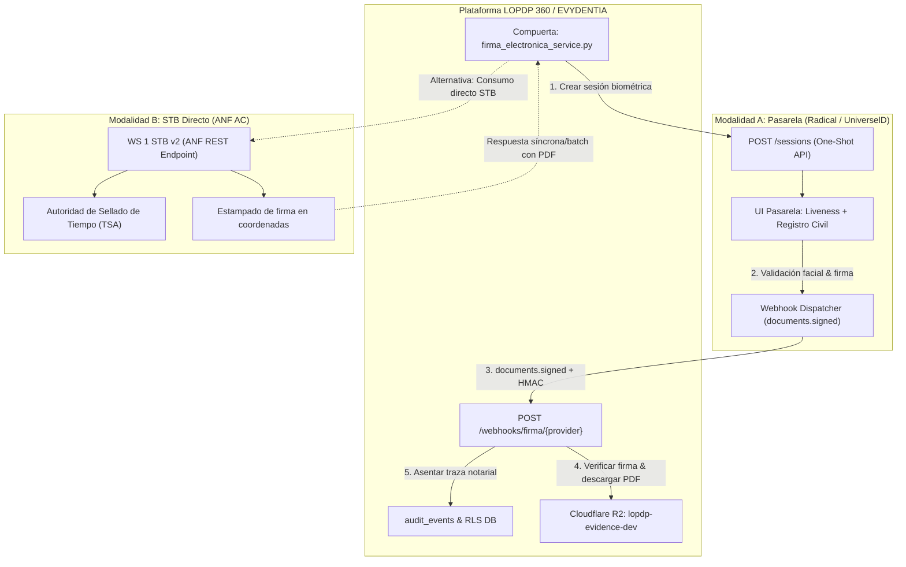

# Boceto Arquitectónico: Sala ADPA Firma Electrónica con ANF y Proveedores Acreditados (FIRMA-01)
`¤adpa` `¤firma-electronica` `¤seguridad`

> **Estado:** Boceto (Fase BBAP, paso 1 - Decisión de diseño D-4 / Aporte 111).  
> **Árbitro:** Aprobación del propietario (usuario humano). Sin proveedor real ni credenciales activas en runtime.
> **Sala ADPA:** `features/firma_electronica`  
> **Compuerta Pública:** `features/firma_electronica/firma_electronica_service.py`

---

## 1. Contexto, Marco Legal y Decisión Doctrinal D-4

En el marco del régimen jurídico de la República del Ecuador:

1. **Ley de Comercio Electrónico, Firmas Electrónicas y Mensajes de Datos (R.O. 557-S, 17-abr-2002):**
   - **Art. 13 (Firma electrónica):** Define la firma electrónica: datos en forma electrónica consignados en un mensaje de datos, adjuntados o lógicamente asociados a él, que pueden servir para identificar al titular de la firma en relación con el mensaje.
   - **Art. 14 (Efectos de la firma electrónica):** La firma electrónica tendrá igual validez y se le reconocerán los mismos efectos jurídicos que a una firma manuscrita en relación con los datos consignados en documentos escritos, y será admitida como prueba en juicio.
   - **Art. 15 (Requisitos de la firma electrónica):** Para su validez requiere ser individual y vinculada exclusivamente a su titular, permitir verificar la autoría e identidad, haber sido creada bajo el control exclusivo del firmante, y que cualquier alteración posterior del mensaje de datos sea detectable.
   - **Art. 17 (Obligaciones del titular), Art. 18 (Duración) y Art. 19 (Extinción):** Las firmas tienen duración indefinida; el Art. 18 remite al reglamento la revocación, anulación y suspensión, y el Art. 19 enumera las causas de extinción. La consulta de listas de revocación (CRL/OCSP) del diseño es una medida técnica propia: su exigencia en el reglamento **no está verificada**.
   - **Art. 20 (Certificado de firma electrónica):** Mensaje de datos que certifica la vinculación de una firma electrónica con una persona determinada, mediante un proceso de comprobación que confirma su identidad.
   - **Art. 29 a 35 (Entidades de certificación de información):** Definición y autorización (29), obligaciones (30), responsabilidades hasta de culpa leve (31), protección de datos personales (32), prestación por terceros (33), terminación contractual (34) y notificación de cese de actividades (35).
   - **Art. 37 (Organismo de regulación, autorización y registro):** Lo atribuye a CONATEL «o la entidad que haga sus veces»; hoy lo ejerce la ARCOTEL (el traspaso de funciones **no está verificado** contra la norma que lo dispuso).
   - **Fuente contrastada:** copia de la Ley No. 2002-67 alojada por ARCOTEL (arcotel.gob.ec, PDF de 2015), leída el 2026-10-18. Puede no incluir reformas posteriores: **no verificado contra el Registro Oficial vigente**. El 2026-10-28 se volvieron a contrastar los Arts. 13, 14 y 20 con el texto reproducido en derechoecuador.com y en la copia del GAD de Tulcán; el Art. 15 se ubica por el índice de la ley (entre «efectos», 14, y «firma en un mensaje de datos», 16) y los Arts. 17 a 19 y 29 a 37 se mantienen de la lectura de 2026-10-18.
2. **Reglamento General a la Ley de Comercio Electrónico (D.E. 3496, R.O. 735, 31-dic-2002):**
   - Normas para la emisión, validación temporal (marcado de tiempo / TSA) y procedimientos de verificación de no repudio.
3. **Resolución ARCOTEL sobre Entidades de Certificación Acreditadas:**
   - La Agencia de Regulación y Control de las Telecomunicaciones (ARCOTEL) es la autoridad de acreditación y control que mantiene el registro oficial de entidades autorizadas en el país.
4. **Ley Orgánica de Protección de Datos Personales (LOPDP):**
   - Exige evidencia documental íntegra e inalterable ($E1+$ a $E3$) para evaluaciones de impacto (EIPD/Assessments), consentimientos expresos de titulares y actas de comités de privacidad, sustentando el principio de responsabilidad proactiva y demostrada (*accountability*, art. 48 LOPDP).
5. **Decisión Doctrinal D-4 y Aporte 111:**
   - Establece la selección e integración con **ANF AC — Autoridad de Certificación Ecuador C.A.** como entidad certificadora acreditada por ARCOTEL, articulada con el ecosistema de EVYDENTIA / SMARTCIDI CIA LTDA.

> [!NOTE]
> **Vacíos o silencios normativos:** Donde la ley o reglamento ecuatoriano no determine expresamente especificaciones técnicas para webhooks asíncronos, formatos de payload JSON o tokens de sesión efímeros de biometría facial remota, se adopta como **diseño propio prudente** la verificación criptográfica HMAC-SHA256, la inmutabilidad notarial SHA-256 en base de datos protegida con Row Level Security (RLS) y el almacenamiento en Cloudflare R2 con trazabilidad en bitácora de auditoría inmutable (`audit_events`).

---

## 2. Ecosistema de Firma Electrónica (Aporte 111)

El ecosistema operativo y societario documentado en el **Aporte 111** (`governance/artefactos/APORTES_INEDITOS.md`) comprende las siguientes identidades y roles:

| Actor / Marca | Razón Social / Entidad | Rol en el Ecosistema | Responsabilidad y Flujo |
| :--- | :--- | :--- | :--- |
| **LOPDP 360 = EVYDENTIA** | JUBYS / Plataforma SaaS propia | Plataforma de Privacidad y Cumplimiento LOPDP | Orquesta las solicitudes de firma de assessments, consentimientos y DPAs; resguarda evidencias auditables. |
| **SMARTCIDI CIA LTDA** | SMARTCIDI CIA LTDA | Empresa titular del propietario | Titular comercial y personería contractual ante las entidades de certificación (ANF AC y Radical/UniverselD). |
| **Radical / GRD / UniverselD / DARKCAM** | Radical / GRD Corporation | Proveedor A: Pasarela One-Shot Biometric | Provee interfaz UI huésped, prueba de vida (liveness), consulta al Registro Civil y emisión de certificado de un solo uso; entrega PDF firmado vía webhook HTTPS. |
| **ANF AC** | ANF Autoridad de Certificación Ecuador C.A. | Proveedor B: WS1 STB (Directo) | Entidad acreditada por ARCOTEL; provee WS 1 STB v2 (emisión de firma temporal, firmado, sello de tiempo TSA y estampado múltiple en coordenadas). Ambiente TEST activo desde 15-oct-2026. |

---

## 3. Sala Confinada ADPA y Compuerta Pública

Conforme a la **Constitución ADPA** (`ADPA.md`) y el **Protocolo Boceto-Sellado BBAP** (`METODOLOGIAS.md`):

```
features/firma_electronica/
├── __init__.py                     # Rastro ¤firma-electronica y delimitación de sala
├── firma_electronica_service.py   # ÚNICA compuerta pública de la sala
└── domain/
    ├── __init__.py                 # Rastro ¤firma-electronica
    └── models.py                   # Modelos de dominio y contratos de intercambio
```

### Invariantes Herméticos de la Sala
1. **Punto Único de Contacto:** Todo llamado proveniente de routers FastAPI (`api/routers/`), tareas asíncronas o salas externas (`dpo`, `assessments`, `consents`) se realiza **exclusivamente** invocando funciones públicas expuestas en `firma_electronica_service.py`. Ningún archivo externo puede importar `features/firma_electronica/domain/*` ni módulos privados.
2. **Cero Dependencias de Red en Boceto:** En esta fase (Paso 1 BBAP), no existen llamadas de red HTTP/REST reales, librerías SOAP pesadas ni secretos en variables de entorno obligatorias para arrancar el sistema.
3. **Multi-Tenant Estricto:** Toda invocación y estructura de datos exige y preserva el `tenant_id` aislado, garantizando compatibilidad nativa con las políticas RLS del motor relacional.

---

## 4. Flujos de Firma y Verificación: Modalidad Pasarela vs. Modalidad STB Directo

La arquitectura soporta dos modalidades complementarias y desacopladas mediante el patrón de compuerta:



### 4.1 Modalidad «Pasarela» (Radical / GRD / UniverselD / DARKCAM)
- **Caso de Uso:** Firmas de ciudadanos o titulares que no disponen de firma electrónica previa y requieren validación biométrica con prueba de vida activa contra el Registro Civil.
- **Flujo:**
  1. *Creación de Sesión:* LOPDP 360 llama a `POST /sessions` enviando datos de la persona (cédula, código dactilar, nombres, correo), URLs de retorno/cancelación y los identificadores de plantilla (`document_ids`).
  2. *Redirección:* La plataforma recibe `verification_url` y la entrega al firmante (redirección web o enlace seguro con TTL de 10 minutos).
  3. *Verificación Remota:* UniverselD ejecuta prueba de vida facial (`liveness`), comparación biométrica facial 1:1 contra foto del Registro Civil de Ecuador y emisión del certificado temporal de un solo uso.
  4. *Recepción Webhook:* UniverselD envía `POST` al webhook de LOPDP 360 (`documents.signed`) adjuntando `session_id`, estado, metadatos y enlaces de descarga temporal (`signed_url`).
  5. *Descarga y Custodia:* LOPDP 360 valida la autenticidad del webhook, descarga el PDF firmado, calcula su hash SHA-256 definitivo y lo resguarda en Cloudflare R2.

### 4.2 Modalidad «STB Directo» (ANF AC — Autoridad de Certificación Ecuador C.A.)
- **Caso de Uso:** Firma de documentos internos corporativos, actas de comité y dictámenes formales donde SMARTCIDI interactúa directamente con los servicios STB de la autoridad acreditada.
- **Flujo (WS 1 STB v2):**
  1. *Generación y Envío de Petición:* LOPDP 360 invoca el servicio STB de ANF AC pasando el JSON técnico con: identificador del cliente (`CLIENTE: "SMART-CIDI"`), datos del firmante, documento base (Base64 o referencia) y matriz de coordenadas de estampado (página, eje X, eje Y).
  2. *Procesamiento ANF:* La autoridad emite la firma temporal o aplica la firma del titular, estampa los sellos visuales en las posiciones especificadas y aplica el sellado de tiempo de autoridad (TSA).
  3. *Soporte Multi-Firma:* Cuando un documento requiere dos o más firmantes, el flujo procesa de forma individual y secuencial a cada firmante garantizando la conservación de firmas previas (PAdES acumulativo).
  4. *Ambiente TEST:* Ficha técnica activa en URL de pruebas de ANF con firmas precargadas para simular respuestas sin consumo arancelario.

---

## 5. Tipología de Datos y Documentos a Firmar

La sala `firma_electronica` da cobertura probatoria exclusiva a tres familias de activos documentales:

1. **Assessments y Evaluaciones de Impacto (EIPD / PIA):**
   - Dictamen técnico de riesgos de tratamiento de datos personales.
   - Aprobación formal del Delegado de Protección de Datos (DPO) y del Responsable del Tratamiento.
2. **Consentimientos Informados y Cláusulas de Tratamiento:**
   - Formularios de consentimiento explícito e inequívoco de titulares.
   - Declaraciones de aceptación de políticas de privacidad para categorías especiales de datos.
3. **Documentos DPA (Data Processing Agreements) y Actas:**
   - Contratos y acuerdos de encargo del tratamiento con terceros encargados (art. 49 LOPDP).
   - Actas formales de sesiones del Comité de Privacidad y Cumplimiento.

---

## 6. Custodia Notarial, Evidencia y Almacenamiento

El sellado probatorio de cada firma culmina con la conservación inalterable en la infraestructura de datos:

1. **Almacenamiento del PDF Firmado (Cloudflare R2):**
   - **Bucket:** `lopdp-evidence-dev` (ambiente desarrollo) / `lopdp-evidence-prod` (ambiente producción).
   - **Ruta de Objeto:** `tenants/{tenant_id}/firmas/{año}/{mes}/{firma_id}_{sha256}.pdf`.
   - **Propiedades del Objeto:** Inmutabilidad, encabezados de tipo de contenido estricto (`application/pdf`) y metadatos con el hash SHA-256 pre y post firma.
2. **Registro Notarial Relacional:**
   - `session_id` del proveedor (UUID de UniverselD o ID de transacción ANF).
   - `sha256_original` y `sha256_firmado` para trazabilidad de integridad matemática.
   - `webhook_payload` completo en formato JSONB indexado para auditoría forense posterior.
3. **Bitácora de Eventos de Auditoría (`audit_events`):**
   - Emisión de un evento tipificado `FIRMA_ELECTRONICA_COMPLETADA` asentando: `actor_id`, `tenant_id`, `timestamp_utc`, `hash_evidencia` y nivel de certeza probatoria alcanzado.

---

## 7. Análisis de Riesgos Legales, de Seguridad y Mitigaciones

### 7.1 Comparativa de Riesgos: «Pasarela» vs. «STB Directo»

| Criterio | Modalidad «Pasarela» (Radical / UniverselD) | Modalidad «STB Directo» (ANF AC) |
| :--- | :--- | :--- |
| **Control de Experiencia (UX)** | Delegado en página del proveedor (marca blanca/co-branding). | Control total en la interfaz de LOPDP 360 (envío directo por API). |
| **Prueba de Vida Biométrica** | Integrada nativamente con verificación activa y cotejo en Registro Civil. | No realiza prueba facial directa en WS1; orientada al firmado y estampado. |
| **Exposición de Credenciales** | Requiere resguardo de `DK_API_KEY` y `DK_WEBHOOK_SECRET`. | Requiere resguardo de API Token STB de ANF. |
| **Superficie de Ataque Webhook** | Expone un endpoint HTTP público para recibir avisos asíncronos. | Petición cliente síncrona o polling; menor riesgo de suplantación webhook. |
| **Caducidad de Enlaces de Descarga** | La `signed_url` del webhook caduca en 24 horas; requiere descarga inmediata. | El documento es devuelto directamente en el payload o canal seguro acordado. |

### 7.2 Verificación Criptográfica de Webhooks (HMAC-SHA256)
Para neutralizar ataques de falsificación de solicitudes (man-in-the-middle o falsos webhooks):
- El proveedor calcula y envía en el cuerpo o encabezado la firma `signature`.
- El algoritmo exigido (conforme a la guía de UniverselD) es:
  $$\text{firma\_esperada} = \text{SHA256}(\text{JSON\_ordenado(aviso)} + \text{DK\_WEBHOOK\_SECRET})$$
- La compuerta debe implementar comparación en tiempo constante (`hmac.compare_digest`) para prevenir ataques de temporización (*timing attacks*).
- Si la verificación falla, se rechaza la petición con código HTTP 401 Unauthorized sin persistir datos en base.

### 7.3 Independencia y Acreditación de la Entidad Certificadora
- La validez jurídica de la firma bajo el Art. 14 de la Ley de Comercio Electrónico, y la del certificado bajo su Art. 20, dependen de que la entidad emisora se encuentre **acreditada ante la ARCOTEL** al momento del firmado.
- La compuerta define en sus metadatos la verificación del estado de acreditación y la consulta de revocación CRL/OCSP.

---

## 8. Alcance Delimitado: Qué Queda Fuera

Para preservar el principio de responsabilidad única y las fronteras de las tareas ADPA:

1. **FE-07 (Autenticación e inicio de sesión con Google):** No forma parte de la sala de firma electrónica; pertenece a la sala de identidad/autenticación (`features/auth`).
2. **Implementación de Código de Red o Producción en esta Tarea:** No se configuran llaves maestras en archivos de entorno, no se realizan llamadas HTTP ni se crean tablas de persistencia en PostgreSQL en este paso.
3. **Firma en Producción:** Queda expresamente sujeta a la aprobación formal jurídica del propietario y a la entrega de credenciales productivas definitivas por parte de ANF AC y Radical/GRD.

---

## 9. Contratos de la Compuerta Pública (`firma_electronica_service.py`)

La compuerta pública expone los siguientes tipos, enumeraciones y funciones:

- `FormatoFirma`: `PADES_BES`, `PADES_B_EPES`, `PADES_B_LTV`, `XADES_BES`.
- `EstadoFirma`: `BORRADOR`, `PENDIENTE_FIRMA`, `FIRMADO`, `RECHAZADO`, `ERROR_VALIDACION`.
- `ProveedorFirma`: `ANF` (directo STB) y `UNIVERSEID` (pasarela One-Shot).
- `CertificadoInfo`: Metadatos del emisor acreditado por ARCOTEL, titular, cédula y vigencia.
- `DocumentoParaFirma`: Descriptor del documento a firmar (`tenant_id`, `sha256_original`, tamaño, MIME).
- `SesionFirmaPasarela`: Parámetros de sesión biométrica para la modalidad pasarela (URL de verificación, TTL).
- `ResultadoFirma`: Atestación auditable de la firma emitida con sellado de tiempo y metadatos.
- `boceto_firmar_documento_anf(...)`: Simulación determinista del firmado directo STB con ANF.
- `boceto_iniciar_sesion_pasarela(...)`: Simulación de la apertura de sesión en pasarela biométrica.
- `boceto_verificar_webhook_pasarela(...)`: Contrato formal de validación HMAC para webhooks de notificación.
- `boceto_verificar_firma(...)`: Validación conceptual de integridad, emisor ARCOTEL y revocación OCSP.
