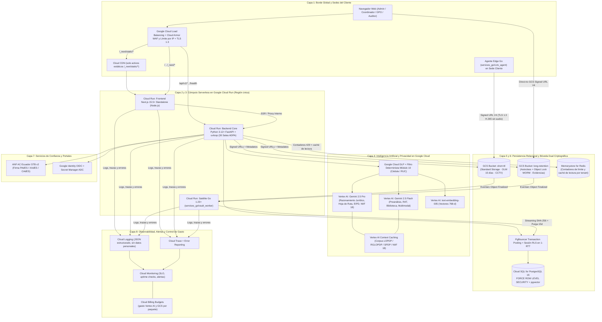

# Product Requirements Document (PRD) — Constitución del Sistema
# EVYDENTIA: Reventa de Nube Certificada y Gobernanza Integral de las 10 Dimensiones LOPDP
`¤artefactos-prd` `¤adpa`
`¤rat` `¤diagnostico` `¤dpo-cockpit` `¤frontend-ide` `¤regulation-code`
`¤roadmap` `¤rbac-tenant` `¤boveda-cloud` `¤videovigilancia-cctv` `¤motor-go-hibrido`
`¤dlp-muestreo` `¤vertex-cache` `¤gemini-vertex` `¤inteligencia-normativa` `¤vigilancia-spdp` `¤cloud-run-perf` `¤niif18`
`¤grado-productivo` `¤limite-peticiones` `¤observabilidad` `¤escalabilidad` `¤cache-aplicacion` `¤empaquetado-seguro` `¤versionado-despliegue` `¤api-integraciones` `¤demo`

---

## 1. Constitución Ejecutiva y Principios Fundacionales
<!-- ¤adpa -->
**Nombre Oficial del Producto:** EVYDENTIA — Reventa de Nube Certificada y Gobernanza de las 10 Dimensiones LOPDP  
**Naturaleza del Sistema:** Plataforma SaaS Cloud-Native multiempresa, multisectorial y multi-organización concebida desde cero sobre **Google Cloud Platform (GCP)** e impulsada nativamente por modelos de Inteligencia Artificial **Google Gemini en Vertex AI**, diseñada para operar el ciclo integral de protección de datos personales en el Ecuador (LOPDP, RGLOPDP y resoluciones vinculantes de la SPDP 2024–2026), el cumplimiento financiero **NIIF 18** y el servicio comercial integrado de **Bóveda Cloud Certificada y Custodia Forense de Videovigilancia**.  
**Propósito Constitucional:** Este documento constituye la **Ley Fundamental y Fuente Única de Verdad Arquitectónica (SSOT)** de EVYDENTIA. Define el sistema en su estado pleno, nativo y definitivo bajo **Arquitectura de Diseño por Pasillo y Aislamiento (ADPA)**, donde cada dominio funcional opera en una sala hermética comunicada exclusivamente a través del Pasillo Central (`app_core/pasillo/`).

### Las 14 Leyes Fundacionales Afirmativas de EVYDENTIA:
1. **Responsabilidad Proactiva y Demostrable (Accountability Real):** El sistema estructura controles, evidencias criptográficas SHA-256, sellos de tiempo y verificaciones independientes para acreditar ante la Superintendencia de Protección de Datos Personales (SPDP) la debida diligencia continua del responsable y del encargado.
2. **Independencia Sagrada del DPD/DPO:** El Delegado de Protección de Datos es un órgano de supervisión autónomo e independiente (Art. 48 LOPDP). Su acceso opera en modo de supervisión, dictamen, objeción y sellado, separado estructuralmente en base de datos y aplicación de toda función de ejecución operativa.
3. **Evidencia Precondicional Verificable ($E1+$):** La acreditación de conformidad de un control o cierre de tarea requiere soporte documental verificable ($E1, E2, E3$) custodiado en la Bóveda Cloud o justificación técnica formal auditada.
4. **Cuadratura Multidimensional SMARTCIDI (1 a 5):** La madurez se evalúa en la escala **SMARTCIDI de 5 niveles** (`1 = Inicial / Ad-hoc`, `2 = Repetible / Intuitivo`, `3 = Definido / Documentado`, `4 = Gestionado / Medido`, `5 = Optimizado / Continuo`) cruzada con el **nivel de evidencia 0 a 4** por control y desglosada en las **4 Dimensiones** (*Gobierno y Cultura*, *Tratamiento y Ciclo de Vida*, *Derechos y Transparencia*, *Seguridad y Resiliencia*), preservando la visibilidad íntegra de cada brecha crítica sin promedios globales que oculten incumplimientos.
5. **Grafo Relacional de Cumplimiento (Compliance Graph SSOT):** Cada entidad del negocio (estructura orgánica, activos, soportes, personas, sedes, tratamientos del RAT, riesgos, EIPD, contratos de encargo, transferencias, incidentes, derechos ARCOP+, documentos y evidencias) se registra una sola vez en el servidor y propaga su estado de forma reactiva y determinista a todas las salas ADPA a través del Pasillo Central.
6. **Normativa Ejecutable ("Regulation as Code"):** La legislación ecuatoriana (LOPDP, RGLOPDP, Resoluciones SPDP) y la norma NIIF 18 viven como paquetes de datos versionados y parametrizados en el servidor, con reglas de aplicabilidad, plazos normativos y listas blancas de evidencia ejecutables por código.
7. **Inteligencia Nativa Google Gemini con Cita Oficial Cerrada y Context Caching:** Toda inferencia cognitiva se ejecuta sobre modelos **Google Gemini en Vertex AI** (`gemini-2.5-pro`, `gemini-2.5-flash` y `text-embedding-005`) aprovechando `Vertex AI Context Caching` sobre el corpus normativo oficial, salidas estructuradas (`response_schema` Pydantic v2), garantía empresarial de **cero entrenamiento** con datos de clientes y citación obligatoria de artículos vigentes.
8. **Privacidad por Diseño, Minimización y Filtrado Cloud DLP:** El sistema opera sobre metadatos, tipologías, colectivos y volúmenes sin almacenar bases de datos masivas de titulares reales, aplicando redacción preventiva determinista (algoritmo Módulo 10 de cédula/RUC ecuatoriano) y escaneo muestreado con **Google Cloud DLP** antes de cualquier indexación o llamada a Vertex AI.
9. **Antecedencia Paramétrica y Poda Ontológica:** El alta y perfilamiento estructural de la organización ($\text{Root}(\mathcal{T}_{\text{poda}}) \prec \mathcal{Q}_{\text{diag}}$) antecede al diagnóstico y a la operación, podando automáticamente los controles, preguntas y plantillas que no aplican a la realidad jurídica y sectorial del tenant.
10. **Aislamiento Probatorio Multidominio:** Cada régimen normativo (LOPDP, NIIF 18) mantiene su propio catálogo y lista blanca de evidencias válidas, garantizando la pureza documental de cada expediente.
11. **Custodia Forense Dual en Bóveda Cloud Certificada:** Todo archivo probatorio o clip de videovigilancia ingresa directamente a **Google Cloud Storage** mediante URLs firmadas V4 y se custodia en doble carril: el **original probatorio inmutable** (con hash SHA-256 calculado en streaming y bloqueo WORM *Object Lock* cuando aplica) y el **derivado ligero de previsualización** (`WebP`, `AVIF` o `WebM`) para inspección instantánea con mínimo consumo de transferencia.
12. **Aislamiento Multi-Tenant en 1-RTT sobre Cloud SQL:** Toda transacción de base de datos se ejecuta sobre **Cloud SQL for PostgreSQL 16** bajo el rol de aplicación sin privilegios `BYPASSRLS`, con `FORCE ROW LEVEL SECURITY` activo en todas las tablas de tenant e inyección de contexto `set_config` en un único viaje de red (1-RTT) sobre `PgBouncer`.
13. **Vigilancia Normativa Continua y Trazabilidad Regulatoria Demostrable:** El sistema no depende de actualizaciones manuales tardías; incorpora un motor de monitoreo automatizado diario (05:00 ECT) de las publicaciones oficiales de la SPDP (`/resoluciones/`, `/marco-normativo/`, `/consultas-absueltas/`) e historial retrospectivo, con verificación de integridad criptográfica SHA-256, deduplicación en 3 capas, custodia de originales inmutables en GCS y validación humana obligatoria (HITL) previa a su asimilación en el Compliance Graph.
14. **Grado Productivo Comercial desde el Origen (`¤grado-productivo`):** EVYDENTIA se vende como servicio en la nube, no como demostración. Por eso nace con los diez pilares de producción comercial descritos en el §5.4, cada uno verificado por su propio árbitro:
    - frontend empaquetado sin mapas de fuente ni secretos;
    - RLS forzada;
    - versionado con despliegue progresivo y reversible;
    - API de integración versionada;
    - hosting gestionado en Google Cloud;
    - seguridad perimetral con Cloud Armor;
    - límites de peticiones y cuotas de consumo por organización;
    - caché de borde y de lectura;
    - escalado acotado;
    - observabilidad con alertas.

    Ninguna capacidad se considera publicable mientras alguno de esos pilares carezca de árbitro en verde.

<!-- ¤adpa/ -->

---

## 2. Modelo de Negocio Integrado: SaaS de las 10 Dimensiones + Reventa de Nube Certificada
<!-- ¤adpa -->
`¤boveda-cloud` `¤videovigilancia-cctv` `¤cartera`

EVYDENTIA unifica en una sola suscripción el **Software de Gobernanza LOPDP / NIIF 18** y la **Bóveda Cloud Certificada de Custodia Probatoria y Videovigilancia**, eliminando para el cliente la complejidad de contratar, configurar y auditar infraestructura criptográfica por separado.

### 2.1 Los Tres Niveles de Cuenta de la Plataforma
| Nivel | Propósito y Alcance | Capacidades Nativas |
| :--- | :--- | :--- |
| **1. Operador de Plataforma (SMARTCIDI)** | Gobierno global del SaaS y del catálogo maestro, sin acceso a los datos privados de ningún cliente (`INV_LOPDP_OPERATOR_NO_TENANT_DATA`). | Alta y ciclo de vida de organizaciones, emisión y revocación de invitaciones de Administrador Inicial, aprovisionamiento de paquetes de Bóveda Cloud, gestión del paquete normativo oficial (`REG-01`) y de la Biblioteca Maestra (Capa 1). |
| **2. Cuenta Profesional (Consultora / Estudio Jurídico / DPO Externo)** | Gestión multi-cliente para firmas implementadoras y Delegados de Protección de Datos que atienden múltiples organizaciones. | Cartera de organizaciones por pertenencia (`ORG-15`) con semáforos en las 4 dimensiones, cambio instantáneo de organización activa (`FE-21`) sin cruce de sesión ni apertura de RLS, y Biblioteca de la Cuenta Profesional (Capa 2) reutilizable en su cartera (`BIB-401`). |
| **3. Organización (Tenant Cliente)** | Entidad jurídica (Responsable o Encargado del tratamiento) donde residen de forma hermética los datos, el RAT, los diagnósticos, la hoja de ruta y la Bóveda Cloud. | Operación completa de los Módulos 0 al 10 bajo control de acceso por roles (RBAC), estructura orgánica por unidades/cargos (`ORG-07`), Biblioteca de la Organización (Capa 3) y cuota dedicada en Google Cloud Storage. |

### 2.2 Paquetes Comerciales de Reventa de Bóveda Cloud (`BOV-01`)
Cada organización tiene asignado un paquete comercial administrado por la sala `features/boveda_cloud/`:

| Paquete Comercial | Almacenamiento Certificado | Cuota de Egress Mensual | Videovigilancia LOPDP (15 días) | Retención Normativa WORM |
| :--- | :--- | :--- | :--- | :--- |
| **Inicial (Micro / Pequeña)** | `50 GB` Dual-Vault | `100 GB / mes` | Hasta 4 cámaras H.265 por eventos | Hasta 5 años con Object Lock |
| **Profesional (Mediana)** | `250 GB` Dual-Vault | `500 GB / mes` | Hasta 16 cámaras H.265 por eventos | Hasta 7 años con Object Lock |
| **Corporativo (Grande / Salud / Financiero)** | `1 TB` Dual-Vault | `2 TB / mes` | Hasta 64 cámaras H.265 por eventos | Hasta 10 años con Object Lock |
| **Enterprise Custom (Gran Escala)** | `Multi-TB` Dedicado | Personalizado con CDN | Ilimitado por sedes y NVR | Personalizado según plazos legales |

* **Control Determinista de Cuotas:** El motor `boveda_cloud` contabiliza en tiempo real los bytes almacenados (`storage_bytes_used`) y los bytes descargados (`egress_bytes_month`). Al alcanzar el 80% emite alerta preventiva al Administrador y al Coordinador; al alcanzar el 100% de la cuota de Egress, restringe las descargas masivas de originales pesados mientras mantiene siempre disponibles los **derivados ligeros (`WebP`/`AVIF`/`WebM`)** y los **paquetes de inspección para la SPDP**.

### 2.3 Límites de Uso y Protección del Saldo por Paquete (`SEC-13`, `API-02`)
`¤limite-peticiones` `¤api-integraciones`

Cada paquete comercial incluye, además de su cuota de almacenamiento, un **techo de uso** que protege la experiencia del cliente y el saldo de la plataforma. Así, ningún tenant ni actor externo puede agotar los recursos compartidos ni el consumo de Vertex AI. Los valores viven como dato del paquete (`features/boveda_cloud/`). El Operador los ajusta sin desplegar código. Los de la tabla son los valores iniciales y parametrizan por paquete las políticas `api_general` e `ia_organizacion` del limitador (`SEC-13`):

| Paquete Comercial | Peticiones a la API por minuto (por organización) | Consumo de IA Gemini al mes (tokens de entrada + salida) | Claves de integración activas | Webhooks suscritos |
| :--- | :--- | :--- | :--- | :--- |
| **Inicial** | `300` | `2 M` | `2` | `2` |
| **Profesional** | `1 200` | `10 M` | `10` | `10` |
| **Corporativo** | `5 000` | `50 M` | `50` | `50` |
| **Enterprise Custom** | Personalizado | Personalizado | Personalizado | Personalizado |

* **Límites transversales independientes del paquete:**
  * inicio de sesión: 10 intentos por IP y minuto (política `inicio_sesion` de `SEC-13`);
  * resto de la API: 300 peticiones por usuario y minuto (política `api_general` de `SEC-13`);
  * portales públicos de titulares y encargados: sus límites propios (`DER-02`, `SEC-12`), que `SEC-13` complementa sin sustituir.
* **Comportamiento al alcanzar un techo:** la API responde `429 Too Many Requests` con cabecera `Retry-After`. Una petición de IA se admite solo si cabe a la vez en el tope del usuario (`ia_usuario`) y en el de la organización (`ia_organizacion`), y se rechaza antes de llamar a Vertex AI. Si el almacén de contadores no responde, la IA se cierra con `503` y el resto de la API sigue abierta. Las alertas de presupuesto al 50, 90 y 100 % (`OPS-07`) avisan antes de agotar el saldo. El resto del sistema sigue operando, incluidas las obligaciones con plazo legal (ARCOP+, vulneraciones, inspección SPDP).

<!-- ¤adpa/ -->

---

## 3. Roles del Sistema, RBAC Multi-Tenant y Segregación de Funciones (SoD)
<!-- ¤adpa -->
`¤rbac-tenant` `¤dpo-independencia` `¤seguridad-tenant`

El control de acceso es determinista, se resuelve en el servidor por organización activa y está respaldado por restricciones e invariantes en PostgreSQL.

| Rol en el Sistema | Naturaleza | Permisos y Responsabilidades Constitucionales | Reglas de Incompatibilidad (SoD) |
| :--- | :--- | :--- | :--- |
| **Operador de Plataforma (`operador_plataforma`)** | Global (Infraestructura y Catálogo) | Crea organizaciones, invita al `admin_organizacion` inicial, revoca/reemite invitaciones, gestiona paquetes de Bóveda Cloud y publica paquetes normativos y plantillas maestras. | Bloqueo absoluto de lectura/escritura sobre tablas de negocio de los tenants (`403 Forbidden` y bloqueo RLS). |
| **Administrador de Organización (`admin_organizacion`)** | Dirección del Tenant | Ejecuta el asistente de alta de 7 pasos, define la estructura orgánica (unidades, cargos, jefaturas, sedes), formaliza las designaciones del DPO y del Coordinador, asigna dominios del assessment y aprueba decisiones de dirección. | No puede acumular el rol de `dpo` en la misma organización (`INV_LOPDP_DPO_INDEPENDENCE`). |
| **Coordinador de Privacidad (`coordinador`)** | Gestión Operativa | Administra el RAT, el inventario de activos/soportes/personas, distribuye tareas de la hoja de ruta a las áreas, gestiona solicitudes ARCOP+, incidentes, terceros y biblioteca documental, y realiza la primera validación de evidencias (4 ojos). | Incompatibilidad estricta con el rol de `dpo`. Cualquier excepción temporal de separación de funciones con responsables de área es explícita, motivada y con fecha de vencimiento (`ORG-02`). |
| **Delegado de Protección de Datos (`dpo`)** | Supervisión Independiente (Art. 48 LOPDP) | Sube al assessment, hasta sellar el diagnóstico real, los documentos de soporte que le entregan el Administrador y los encargados; revisa el assessment en la grilla Declarado vs Verificado, objeta respuestas, sella el diagnóstico de prueba y el real; después del sello del real no sube evidencia y solo valida o rechaza la nueva; emite dictámenes vinculantes en su Cockpit, supervisa EIPD y vulneraciones, autoriza *Hold Legal* y cierra tareas con el segundo par de ojos. Puede pertenecer a múltiples organizaciones en cartera (`ORG-13`). | **Barrera SoD Absoluta:** Un usuario con rol `dpo` en una organización no puede tener ningún rol operativo (`admin_organizacion`, `coordinador`, `responsable_area`, `implementador`) en esa misma organización, ni ser asignado como ejecutor de tareas operativas. |
| **Responsable de Área (`responsable_area`)** | Ejecución por Unidad Orgánica | Responde los dominios del assessment asignados a su unidad y entrega al DPO sus documentos de soporte, ejecuta las tareas del plan de acción de su área, carga las evidencias de esas tareas en la Bóveda Cloud y participa en las actas de auditoría de su unidad. | Alcance circunscrito a las unidades orgánicas de su jefatura (`ORG-07`), sin permiso para auto-aprobar el cierre definitivo de sus propias tareas. |
| **Implementador / Consultor (`implementador`)** | Asesoría Externa Multi-Tenant | Acompaña la configuración del RAT, redacción documental en Biblioteca, preparación de EIPD y estructuración de planes de acción en las organizaciones de su cartera (`ORG-13`). | No sustituye la firma de dirección ni el sello independiente del DPO. |
| **Auditor Interno / Externo (`auditor`)** | Aseguramiento Independiente | Ejecuta programas de auditoría por dominio (`CAPA-04`), levanta actas por área, califica controles periódicos y verifica el cierre de acciones correctivas (CAPA). | No ejecuta las tareas operativas que él mismo audita. |

<!-- ¤adpa/ -->

---

## 4. Arquitectura Funcional de las 10 Dimensiones y los 11 Módulos del Sistema
<!-- ¤adpa -->

### Módulo 0: Alta Estructural de la Organización, Poda Ontológica y Cartera Multi-Tenant
`¤alta-organizacion` `¤cartera` `¤inventario`
* **Asistente de Alta en 7 Pasos (`ORG-16`):** Flujo guiado en servidor con guardado progresivo (`FE-23`) que captura: (1) Identificación societaria y RUC validado, (2) Régimen (público/privado) y sector económico, (3) Tamaño organizacional canónico (`micro`, `pequena`, `mediana`, `grande`), (4) Sedes y establecimientos (`ORG-18`), (5) Estructura orgánica de unidades, cargos y jefaturas (`ORG-07`), (6) Designaciones formales del DPO (con estado de inscripción SPDP y declaración de ausencia de conflicto de interés) y mandato del Coordinador (`ORG-06`), y (7) Perfil de tratamientos especiales (salud, biometría, menores, videovigilancia, transferencias internacionales, actuación como encargado para clientes corporativos).
* **Árbol de Poda Ontológica y Whitelist Dinámica:** Al sellar o actualizar la ficha organizacional, el motor determina automáticamente qué controles, obligaciones MTGE, preguntas del diagnóstico y plantillas documentales son aplicables, y activa la lista blanca de formatos probatorios del régimen seleccionado.
* **Papelera Reversible y Portabilidad Completa (`ORG-20`):** Archivado lógico con restauración trazable y exportación íntegra del expediente de la organización en paquete estructurado y firmado.

---

### Módulo 1: Discovery y Assessment Adaptativo en 60 Minutos
`¤diagnostico` `¤diagnostico-motor` `¤diagnostico-scoring` `¤diagnostico-reporte` `¤diagnostico-asignacion` `¤diagnostico-no-aplica` `¤diagnostico-comparativo`
* **Banco Canónico de 80 Preguntas en Servidor (`DIAG-02`):** Catálogo estructurado `P1–P80` organizado por las 4 Dimensiones y los 10 Dominios de control de la LOPDP, con poda condicional en tiempo real ($\le 80$ preguntas efectivas, $\le 60$ minutos).
* **Asignación Colaborativa por Dominios (`DIAG-04`):** El Administrador asigna dominios específicos del assessment a los encargados del diagnóstico / responsables de área según su unidad orgánica.
* **Regla de Justificación de «No Aplica» (`DIAG-05`):** Toda respuesta marcada como «No aplica» exige justificación técnica documentada y persiste sujeta a validación del DPO.
* **Flujo Declarado vs. Verificado y Sello Inmutable del DPO (`DIAG-03`, `DIAG-07`):** El Administrador y los encargados asignados registran las respuestas declaradas junto con el nivel SMARTCIDI (1 a 5) y el nivel de evidencia (0 a 4), y **entregan los documentos de soporte al DPO, que es quien los sube** al diagnóstico. Sellado el diagnóstico real, el DPO ya no sube evidencia: la nueva llega por las tareas del plan de acción y él solo la valida o la rechaza (`INV_LOPDP_DIAG_EVIDENCE_DPO_UNTIL_SEAL`). El DPO revisa el assessment en su **Grilla Declarado / Verificado**, formula objeciones vinculantes por pregunta cuando la evidencia es insuficiente y, una vez subsanadas o calificadas, **sella criptográficamente el diagnóstico** (`SHA-256`), tornándolo inmutable en la base de datos.
* **Motor de Scoring Multidimensional SMARTCIDI (`DIAG-08`, `DIAG-09`, `DIAG-10`):** Calcula para cada control el nivel asignado (1 a 5) y la calidad de evidencia (0 a 4), agrega los resultados por **Dimensión** y por **Dominio** sin emitir un porcentaje global engañoso, y alimenta el **Tablero Ejecutivo de las 4 Dimensiones (`FE-24`)** y la **Ficha Resumen Fija (`FE-25`)**.
* **Diagnóstico de prueba y diagnóstico real (`DIAG-11`):** El diagnóstico se hace una sola vez y admite **dos sellos**. El primero es el **diagnóstico de prueba**. Después, el Administrador puede entregar información que no había mostrado; se corrigen las respuestas y el DPO sella el **diagnóstico real**, que es la línea base. Si no hay información nueva, el DPO sella el real sin cambios. No hay un tercer sello (409): las 80 preguntas no se vuelven a contestar (`INV_LOPDP_DIAG_TRIAL_THEN_REAL`). Los dos son assessments de diagnóstico.
* **Estados: el assessment actual (`DIAG-12`):** Después del diagnóstico real, la madurez se sigue con **estados**: cortes fechados que emite y sella el DPO, que parten del diagnóstico real y suman las tareas del plan de acción cerradas con evidencia validada por el DPO. Cada estado es un assessment actual; ninguno modifica los diagnósticos sellados.
* **Comparativo Histórico con Línea Base (`DIAG-06`, `DIAG-12`):** `DIAG-06` contrasta el diagnóstico de prueba con el real. `DIAG-12` contrasta cada estado con el diagnóstico real o con el estado anterior. Ambos muestran la evolución neta por dimensión y dominio.

---

### Módulo 2: Operación Continua de las 10 Dimensiones y el Compliance Graph
`¤rat` `¤mtge-granescala` `¤derechos` `¤incidentes` `¤transferencias` `¤conservacion` `¤inventario` `¤dlp-muestreo`
* **2.1 Inventario Ampliado de la Organización (`ORG-17`, `ORG-18`):** Registro relacional en servidor de **Activos y Sistemas**, **Soportes físicos y digitales**, **Personas mínimas / Custodios**, **Sedes** y **Clientes corporativos** (cuando la organización actúa como Encargada del Tratamiento).
* **2.2 RAT Maestro Versionado y Descubrimiento con Cloud DLP (`RAT-01..07`, `DLP-01`):**
  * Registro de Actividades de Tratamiento con todos los campos exigidos por la LOPDP y la SPDP, arranque asistido por plantillas sectoriales (incluyendo catálogo de establecimientos de salud `RAT-02`), reglas de validación jurídicas y **versionado inmutable por ficha de tratamiento (`RAT-05`)**.
  * **Colectivos de Titulares y Registro de Consentimientos por Finalidad (`RAT-07`):** Gobernanza de colectivos y trazabilidad de bases de legitimación y consentimientos sin almacenar bases nominales innecesarias.
  * **Descubrimiento Muestreado con Cloud DLP (`DLP-01`):** Escaneo de muestras de archivos y esquemas tabulares combinando **Google Cloud DLP** y el validador determinista **Módulo 10** de cédulas y RUC ecuatorianos para detectar datos identificativos, patrimoniales o de salud y poblar automáticamente el borrador del RAT.
  * **Exportación Oficial (`RAT-06`):** Generación en servidor de los reportes oficiales del RAT en formatos `XLSX` y `PDF` con la versión vigente de cada ficha.
* **2.3 Motor Determinista de Gran Escala — MTGE (`MTGE-01`, `MTGE-02`):**
  * Implementación exacta de la **Resolución SPDP-SPD-2026-0005-R** con sus 6 variables ponderadas (titulares 0–4, volumen de tipos de datos 0–3, categorías sensibles 0–3, frecuencia 0–2, permanencia 0–2, alcance geográfico 0–2), umbral $\ge 6$ puntos y activadores directos (salud/biométricos/genéticos, perfilamiento o decisiones automatizadas, vigilancia sistemática/videovigilancia pública, geolocalización/comportamental, scoring crediticio/financiero, datos de niños/niñas/adolescentes y transferencias sistemáticas).
  * Disparo automático de las obligaciones legales de Gran Escala: EIPD obligatoria, designación e inscripción de DPO, auditoría anual, informe anual y actualización de políticas.
* **2.4 Gestión de Derechos de Titulares ARCOP+ y Portal Público (`DER-01`, `DER-02`, `SEC-08`, `SEC-09`):**
  * Flujo completo de solicitudes de Acceso, Rectificación y Actualización, Eliminación, Oposición, Portabilidad y No ser objeto de decisiones automatizadas, con verificación de identidad, reloj normativo de respuesta (15 días para acceso/eliminación/oposición; 5 días para rectificación/actualización), modelos de contestación y archivo automático de la respuesta firmada como evidencia.
  * **Portal Público de Titulares por Organización (`DER-02`, `SEC-12`):** Canal externo seguro con enlace único de seguimiento criptográfico y protección contra enumeración.
* **2.5 Gestión de Vulneraciones de Seguridad en 8 Secciones (`INC-01`, `INC-02`, `LEG-02`):**
  * Asistente estructurado en las **8 secciones de la Norma Técnica de Notificación de Vulneraciones (Res. SPDP-SPD-2026-0040-R)**: detección y triaje, naturaleza de la brecha, categorías y volumen de titulares afectados, evaluación de severidad e impacto en derechos, medidas de contención con CSIRT/ARCOTEL, decisión motivada de notificación a la SPDP (plazo de 72 horas / 5 días según supuesto legal) y a los titulares (72 horas cuando entraña alto riesgo), generación de informes oficiales y congelamiento automático de evidencias conexas en la Bóveda Cloud.
* **2.6 Terceros, Encargados y Transferencias Internacionales (`TER-01`, `TER-02`, `ADPA-08`):**
  * Salas dedicadas `features/terceros/` y `features/transferencias/` con monitoreo continuo de contratos de encargo y garantías de transferencia internacional.
  * Generación automática de hallazgos cuando un encargado carece de contrato vigente o una transferencia internacional carece de garantía habilitante (`TER-01`).
  * **Portal Externo de Debida Diligencia de Encargados (`TER-02`, `SEC-12`):** Cuestionario de garantías de seguridad respondido por el proveedor externo mediante token seguro, con revisión del Coordinador/DPO e informe de calificación.
* **2.7 Conservación, Bloqueo y Destrucción Segura (`CON-01`, `ADPA-09`):**
  * Sala `features/conservacion/` conectada al RAT, a la Bóveda Cloud y al Cockpit del DPO para gobernar los plazos legales de retención, el bloqueo jurisdiccional (*Hold Legal*) y la ejecución de purgas o anonimizaciones con emisión de actas criptográficas de destrucción SHA-256.
* **2.8 Formación Continua y Cultura de Privacidad (`FOR-01`, `ADPA-09`):**
  * Sala `features/formacion/` que gestiona programas de capacitación por unidad orgánica y rol, cápsulas formativas, evaluación mediante examen calificable y emisión de constancias/diplomas que se vinculan automáticamente como evidencia verificable de capacitación del personal.

---

### Módulo 3: Auditorías por Dominio, Controles Periódicos, Riesgos y EIPD en 8 Pasos
`¤auditoria-programa` `¤auditoria-capa` `¤controles-periodicos` `¤riesgos-eipd`
* **Controles Periódicos Automatizados (`CAPA-02`, `CAPA-03`):** Programación de controles recurrentes con frecuencia y responsable asignado. Si un control vence sin ejecución o si la evidencia que lo sustenta pierde vigencia (`CAPA-03`), el sistema reabre automáticamente el control y genera un hallazgo trazable hacia el Plan de Acción Único.
* **Auditoría por Dominio y Actas por Área (`CAPA-04`):** Ejecución de auditorías sobre snapshots normativos con grilla de verificación por dominio, levantamiento de actas formales por unidad orgánica y conversión directa de las no conformidades en hallazgos del plan de acción.
* **Matriz de Riesgos 5×5 y Sensor de Deriva (`RAT-03`):** Evaluación de probabilidad e impacto inherente y residual por actividad del RAT, con alerta reactiva ante incrementos de volumen ($\ge 25\%$) o incorporación de categorías sensibles/biométricas.
* **EIPD Guiada en 8 Pasos (`MTGE-03`):** Asistente completo de Evaluación de Impacto en la Protección de Datos Personales con: (1) Asistente de obligatoriedad vinculado al MTGE, (2) Descripción sistemática del tratamiento, (3) Evaluación de necesidad y proporcionalidad asistida por **Gemini 2.5 Pro**, (4) Identificación de amenazas sobre derechos y libertades, (5) Matriz de riesgo inherente 5×5, (6) Plan de controles y salvaguardas técnicas/organizativas, (7) Riesgo residual y dictamen vinculante del DPO, y (8) Decisión documentada de dirección (incluyendo consulta previa a la SPDP cuando el riesgo residual permanece alto) e informe final sellado.

---

### Módulo 4: Cockpit de Supervisión e Independencia del DPD/DPO
`¤dpo-cockpit` `¤dpo-asesoria` `¤dpo-independencia` `¤dpo-informe-anual`
* **Bitácora Inmutable con Cadena de Huellas (`DPO-01`):** Registro cronológico de todas las actuaciones, revisiones, objeciones y dictámenes del DPO, encadenado criptográficamente por organización (`prev_hash` + `entry_hash` SHA-256) para garantizar el no-repudio probatorio.
* **Bandeja de Consultas Internas al DPO (`DPO-03`):** Canal formal mediante el cual el Administrador, el Coordinador o los Responsables de Área elevan consultas preventivas (Privacidad desde el Diseño, nuevos tratamientos, incidentes o dudas de licitud) y reciben el dictamen versionado del DPO, que queda archivado automáticamente como evidencia de asesoría.
* **Informe Anual del DPO e Inscripción ante la SPDP (`DPO-02`):** Compilación automática de la memoria anual de gestión del DPO a partir de su bitácora, el estado de los hallazgos, las EIPD dictaminadas, las solicitudes ARCOP+ y las vulneraciones atendidas, junto con el control de vigencia de su registro oficial ante la SPDP.

---

### Módulo 5: Hoja de Ruta Inteligente (Gemini 2.5 Pro), Plan de Acción Único y Firma Electrónica
`¤roadmap` `¤hallazgos` `¤firma-electronica`
* **Plan de Acción Único y Compuerta de Hallazgos (`RM-21`):** Todo hallazgo originado en el Assessment (`diagnostico`), en Controles Periódicos o Auditorías (`auditoria_capa`), en el validador del RAT (`rat`), en EIPD (`riesgos_mtge`) o en el monitoreo de Terceros y Transferencias (`terceros`, `transferencias`) ingresa por una **única compuerta canónica** en `features/roadmap/` que lo transforma en tareas accionables sin duplicar planes de trabajo (`INV_LOPDP_SINGLE_ACTION_PLAN`).
* **Generación Inteligente con Google Gemini 2.5 Pro (`RM-12`, `RM-13`, `RM-19`):** El motor de planeación en `features/roadmap/` invoca **`gemini-2.5-pro` en Vertex AI** con *Structured Outputs* (`response_schema` Pydantic v2) consumiendo el diagnóstico real (`P1–P80`), el inventario del RAT y el tamaño de la organización para estructurar olas de implementación priorizadas por urgencia jurídica y reducción de riesgo.
* **Vistas Operativas de Lista, Tablero Kanban y Cronograma (`RM-22`):** Visualización multi-perspectiva con trazabilidad al hallazgo de origen, semáforo de vencimiento, distribución por área orgánica (`RM-08`, `ORG-12`), edición controlada (`RM-07`), cierre automático de hallazgos al completarse todas sus tareas y recordatorios por correo (`RM-23`).
* **Validación de Cuatro Ojos (`INV_LOPDP_FOUR_EYES_CLOSURE`):** El cierre definitivo de toda tarea del plan de acción exige dos validaciones independientes registradas en `audit_events`: la validación operativa del Coordinador y la verificación independiente del DPO o Auditor.
* **Firma Electrónica Certificada y Aceptación con Acuse (`FIRMA-01..06`, `FIRMA-02`):**
  * **Firma Criptográfica Real con ANF AC Ecuador STB v2 (`FIRMA-01`, `FIRMA-03..06`):** Sala `features/firma_electronica/` conectada a la API REST v2 de **ANF Autoridad de Certificación Ecuador (Sign Time Box)** para firmas `PAdES` (PDF), `XAdES` y `CAdES` con sello de tiempo criptográfico y verificación de estado.
  * **Aceptación Simple con Acuse Probatorio (`FIRMA-02`):** Modalidad ágil para políticas internas, acuerdos de confidencialidad y constancias operativas que registra nombre, correo autenticado, marca temporal UTC, dirección IP y huella `SHA-256` del documento, con verificador público de integridad por hash.
* **Motor de Notificaciones Transaccionales y por Lote (`NOTIF-01`):** Sala `features/notificaciones/` que agrupa avisos de asignación de tareas, vencimientos próximos, objeciones del DPO, alertas normativas y solicitudes de firma sin saturar de correos individuales a los usuarios.

---

### Módulo 6: Inteligencia Normativa, Vigilancia Regulatoria SPDP, "Regulation as Code" y Copiloto IA con Google Gemini en Vertex AI
`¤inteligencia-normativa` `¤vigilancia-spdp` `¤regulation-code` `¤paquete-normativo` `¤copiloto-ia` `¤gemini-vertex` `¤vertex-cache`
* **6.1 Motor de Monitoreo Automatizado e Ingesta SPDP (BRF-001 / `RF-01..05`):**
  * **Monitoreo Diario y Programado (`RF-01`):** Tarea programada en Google Cloud Scheduler a las 05:00 ECT (`America/Guayaquil`, UTC-5) y gatillo de ejecución manual para el Operador SMARTCIDI y DPO, registrando cada corrida con duración, documentos detectados y telemetría de fallos en `normativa_monitoreo_logs`.
  * **Detección y Cobertura Retrospectiva (`RF-02`):** Rastreo semántico del portal oficial de la SPDP (`/resoluciones/`, `/marco-normativo/`, `/docs/` y `/consultas-absueltas/`), comparando los documentos encontrados contra el inventario y recuperando publicaciones retrospectivas de años anteriores.
  * **Deduplicación y Control de Versiones en 3 Capas (`RF-03`):** Coincidencia unívoca por número oficial y año (`SPDP-SPD-YYYY-NNNN-R`), hash `SHA-256` del contenido y detección de modificaciones en la fuente (republicación o fe de erratas) conservando el historial inmutable en `normativa_versiones`.
  * **Descarga, Validación e Integridad Criptográfica (`RF-04`):** Verificación de cabeceras mágicas PDF (`%PDF-`), cálculo de hash `SHA-256` en streaming y custodia del documento original intacto en Google Cloud Storage (`gs://evydentia-corpus-normativo/spdp/`).
  * **Repositorio Documental Estructurado (`RF-05`):** Registro de 15 metadatos canónicos en `normativa_resoluciones`, diferenciando vigencia verificada de estado pendiente de revisión jurídica (`pendiente_revision`, `homologada`, `observada`, `vigente`, `reformada`, `derogada`).
* **6.2 Consulta, Búsqueda y Notificaciones de Vigilancia (`RF-06`, `RF-07`):**
  * Búsqueda multifacética por número, año, palabra clave, órgano y materia regulada, visor PDF integrado y descarga controlada del PDF conservado mediante URL firmada V4.
  * Despacho de notificaciones transaccionales al Administrador y DPO ante resoluciones nuevas o modificadas y alertas técnicas de monitoreo.
* **6.3 Pipeline Cognitivo con Google Gemini en Vertex AI (Fase 2 BRF-001 / `VTX-01`):**
  * Extracción y chunking de texto limpio, indexación vectorial con `text-embedding-005` en `pgvector`.
  * Regeneración e invalidación automática del recurso `CachedContent` en Vertex AI Context Caching (`corpus_sha256`).
  * Análisis de impacto regulatorio con `gemini-2.5-pro` sobre el Assessment (Módulo 1), el RAT (Módulo 2), las tareas de la Hoja de Ruta (Módulo 5) y las plantillas documentales (Módulo 7).
  * Principio HITL Inviolable: Ninguna sugerencia de derogatoria u obligación jurídica emitida por IA es definitiva sin homologación humana formal competente.
* **6.4 Paquete Normativo Versionado como Dato (`REG-01`) y Centro de Conocimiento (`REG-02`):**
  * La LOPDP, el RGLOPDP, las Resoluciones SPDP (MTGE, Vulneraciones, DPO, Sanciones, Transferencias) y la norma NIIF 18 se almacenan como paquetes estructurados con artículos, obligaciones, plazos parametrizados y reglas de aplicabilidad editables exclusivamente por el Operador de Plataforma.
  * Centro de Conocimiento interactivo navegable desde cualquier pantalla y desde la Command Palette (`Ctrl + K`), con resúmenes ejecutivos, concordancias legales y ayuda contextual vinculada a cada control y pregunta del sistema.
* **6.5 Arquitectura Cognitiva Nativa sobre Google Gemini en Vertex AI (`VTX-01`, `¤gemini-vertex`):**
  * **Familia de Modelos Gemini Desplegada:**
    1. **`gemini-2.5-pro` (Motor de Razonamiento Jurídico y Regulatorio Profundo):** Utilizado para la generación de la Hoja de Ruta Inteligente, el análisis de proporcionalidad y necesidad en EIPD, la redacción de dictámenes complejos del Copiloto DPO, el análisis de impacto de reformas normativas sobre la Biblioteca Documental y el razonamiento contable NIIF 18.
    2. **`gemini-2.5-flash` (Motor de Baja Latencia, Asistencia en Caliente e Inspección Multimodal):** Utilizado para el autocompletado y sugerencia de tratamientos en el RAT, asistencia en vivo durante el Assessment de 60 minutos, rellenado guiado de variables en plantillas de la Biblioteca, triaje preliminar de solicitudes ARCOP+ y verificación visual de cartelería informativa y máscaras de privacidad en Videovigilancia.
    3. **`text-embedding-005` (Motor de Embeddings Semánticos 768-d):** Utilizado para vectorizar el corpus normativo ecuatoriano y la doctrina contable dentro de `pgvector` en Cloud SQL PostgreSQL 16.
  * **Vertex AI Context Caching (`VTX-01`, `¤vertex-cache`):** El servicio `features/regulacion_rag/services/vertex_context_cache.py` empaqueta el corpus normativo vigente de Ecuador en un recurso `CachedContent` de Vertex AI identificado unívocamente por su huella `corpus_sha256`. Todas las consultas de `ai_copilot` y `regulacion_rag` reutilizan el `cache_name` activo, reduciendo hasta en un 90% el consumo de tokens de entrada y garantizando respuestas fundamentadas en el texto íntegro de la ley. Cuando el Operador publica una nueva versión del paquete normativo (`REG-01`), el cambio de `corpus_sha256` invalida automáticamente la caché anterior y aprovisiona la nueva.
  * **Guardrails Constitucionales Pre-Inferencia y Post-Inferencia:**
    * **Filtro DLP Módulo 10 Pre-Vuelo (`INV_LOPDP_DLP_ECUADORIAN_CEDULA_MODULO10`):** Antes de invocar cualquier endpoint de Vertex AI, el motor `vertex_cached_rag_engine.py` inspecciona el prompt y redacta determinísticamente toda cédula o RUC ecuatoriano válido como `[CEDULA-REDACTADA]`, además de enmascarar correos y teléfonos personales.
    * **Citación Oficial Cerrada (`INV_LOPDP_AI_RAG_STRICT_CITATION`):** Toda respuesta generada por Gemini incluye la cita explícita del artículo y cuerpo normativo del corpus en caché; si una consulta carece de sustento en el corpus oficial, el motor declara expresamente la ausencia de base normativa sin extrapolar ni alucinar preceptos.
    * **Autenticación IAM sin API Keys y Cero Entrenamiento:** La conexión a Vertex AI se realiza 100% mediante *Application Default Credentials (ADC)* de la cuenta de servicio de Cloud Run, bajo las garantías empresariales de Google Cloud donde ningún prompt ni respuesta de los tenants se utiliza para entrenar modelos de terceros.

---

### Módulo 7: Biblioteca Documental Inteligente de Tres Capas y Generación Guiada
`¤adpa` `¤evidencias` `¤roadmap`
* **Arquitectura de Tres Capas de Plantillas (`BIB-101..109`, `BIB-401`):**
  1. **Capa 1 — Biblioteca Maestra (Operador SMARTCIDI):** Catálogo oficial versionado de políticas, cláusulas, contratos de encargo, avisos de privacidad, registros, actas y procedimientos alineados a la LOPDP y resoluciones SPDP.
  2. **Capa 2 — Biblioteca de la Cuenta Profesional (`BIB-401`):** Plantillas propias o adaptadas por la firma consultora / estudio jurídico para reutilizar de forma estandarizada en todas las organizaciones de su cartera.
  3. **Capa 3 — Documentos de la Organización (`BIB-107`, `BIB-113`):** Expediente documental vivo de cada tenant, que incluye tanto los documentos generados desde plantillas como los documentos externos preexistentes subidos por el cliente (`BIB-106`).
* **Aplicabilidad Explicable y Reutilización del Compliance Graph (`BIB-201..204`):** Cada ficha de plantilla declara sus reglas de aplicabilidad (`BIB-204`) explicando al usuario por qué es obligatoria o recomendada según su ficha organizacional, su RAT y su cálculo MTGE. Los formularios de captura por versión (`BIB-201`, `BIB-203`) pre-rellenan automáticamente las variables y tablas desde la Ficha Organizacional, el Diagnóstico y el RAT indicando la procedencia exacta de cada dato (`BIB-202`).
* **Motor de Generación Nativa Word (`DOCX`), Excel (`XLSX`) y Vista Previa Fiel (`BIB-205..208`):** Generación asíncrona y concurrente en servidor (`BIB-207`) de documentos editables `.docx` y libros `.xlsx` con fidelidad tipográfica, vista previa integrada (`BIB-206`) y descarga controlada con marca de estado (`BIB-104`).
* **Ciclo de Vida de 9 Estados e Integración con Acciones, Evidencias y Cambios Normativos (`BIB-301..307`, `BIB-402`):**
  * Flujo trazable: `borrador` → `en_revision` → `observado` → `aprobado` → `pendiente_firma` → `vigente` → `vencido` → `reemplazado` → `archivado`.
  * Vinculación directa con tratamientos del RAT, controles y tareas del Plan de Acción (`BIB-302`, `BIB-402`): cuando un documento alcanza el estado `vigente` (aprobado y firmado), se registra automáticamente como evidencia verificable (`BIB-303`) y notifica si un cambio posterior en el RAT o en el Paquete Normativo (`BIB-304`) exige actualizarlo.

---

### Módulo 8: Bóveda Cloud Dual en Google Cloud Storage, Carril Forense y Orquestador Comercial
`¤boveda-cloud` `¤evidencias` `¤evidencias-vigencia` `¤motor-go-hibrido`
* **Arquitectura de Bóveda Dual en Google Cloud Storage (`BOV-02`):** El motor `gcs_dual_vault_engine.py` segrega físicamente los objetos por política de ciclo de vida para optimizar costos y cumplimiento legal:
  1. **Bucket / Pool `short-ttl` (Standard Storage sin Autoclass):** Destinado a grabaciones de videovigilancia ordinaria y archivos transitorios con retención estricta de $\le 15\text{ días}$ y regla `Object Lifecycle Management (OLM)` de borrado determinista al día 15, evitando penalizaciones de tamaño mínimo o borrado temprano.
  2. **Bucket / Pool `long-retention` (Autoclass + Retention Policy WORM):** Destinado a evidencias normativas (`EVI-01`, `EVI-02`), diagnósticos sellados, informes del DPO, contratos firmados, actas de destrucción y clips de videovigilancia bajo *Hold Legal*, con transición automática de frío (`Standard` ➔ `Nearline` ➔ `Coldline` ➔ `Archive`) y bloqueo inmutable *Write-Once-Read-Many* (`Object Lock`).
* **Ingesta Direct-to-GCS sin Tránsito por RAM (`BOV-02`):** La carga y descarga de archivos pesados se realiza mediante **URLs firmadas V4 de Google Cloud Storage** con cabeceras de tipo MIME, tamaño máximo y prefijo aislado por `tenant_id`, liberando la memoria RAM de los contenedores Cloud Run.
* **Carril Forense Dual: Original Intacto SHA-256 + Derivado Ligero (`BOV-03`):**
  * **Carril 1 (Original Probatorio Inmutable):** El archivo original jamás se recodifica ni altera; el satélite en Go `services_go/vault_worker` calcula su huella `SHA-256` en streaming al aterrizar en GCS (`Eventarc`) y asienta el sello en PostgreSQL.
  * **Carril 2 (Derivado Ligero de Inspección):** Para imágenes y videos se genera asíncronamente una copia optimizada (`WebP` / `AVIF` para imágenes, `WebM` ligero para video) que la interfaz muestra por defecto en las pantallas de revisión del Coordinador y del DPO, reduciendo en más del 85% el consumo de Egress.
* **Paquete de Inspección Ordenado por Requisito (`EVI-02`) y Orquestador Comercial de las 10 Dimensiones (`BOV-04`):** Panel ejecutivo unificado que consolida la vigencia de todas las evidencias, exporta paquetes de inspección listos para auditoría de la SPDP y gobierna en una sola vista las cuotas de almacenamiento/Egress, las automatizaciones de retención, las actas criptográficas de purga y el estado de los satélites.

---

### Módulo 9: Gobernanza Automatizada de Videovigilancia LOPDP y Agente Edge en Go
`¤videovigilancia-cctv` `¤motor-go-hibrido` `¤conservacion`
* **Inventario de Cámaras/NVR y Auditoría de Perfil Técnico (`CCTV-01`):** Registro por sede de cámaras y grabadores NVR con verificación automatizada del estándar técnico de privacidad por diseño:
  * Compresión **H.265 (HEVC)** a `1080p`, `10–15 FPS`, bitrate máximo `1.5 Mbps`.
  * Grabación **exclusivamente por detección de movimiento / eventos** (reducción del 80% de almacenamiento y transferencia frente a grabación continua 24/7).
  * **Canal de audio deshabilitado por defecto** (`audio_enabled = False`), previniendo la captación desproporcionada de conversaciones privadas salvo justificación legal expresa y dictamen favorable del DPO.
  * Máscaras de privacidad sobre vía pública y vinculación automática de cada cámara con su ficha en el RAT y su cartelería informativa obligatoria.
* **Agente Edge Compilado en Go (`GOCA-01` — `services_go/cctv_agent`):** Binario ligero multiplataforma (`Linux`/`Windows` `amd64`/`arm64`) aprovisionado desde EVYDENTIA con un paquete de configuración firmado (`cctv_provisioning_bundle.py`). Se conecta localmente por RTSP/ONVIF a las cámaras o NVR de la sede del cliente, recorta los clips de eventos en H.265, suprime la pista de audio en origen, calcula el `SHA-256` local y sube el segmento directamente por TLS 1.3 a la Bóveda `short-ttl` de GCS mediante URLs firmadas V4.
* **Ciclo Quincenal de Destrucción con Acta SHA-256 y *Hold Legal* Forense (`CCTV-02`, `GOVW-01`):**
  * **Purga Automática a los 15 Días:** Todo clip ordinario vence a los 15 días de su captura; el worker en Go `vault_worker` ejecuta la purga y emite un **Acta Quincenal de Destrucción Segura** firmada con el árbol de hashes `SHA-256` de los segmentos eliminados, que se conserva permanentemente en el Cockpit del DPO como prueba de cumplimiento del principio de conservación limitada.
  * **Congelamiento Forense (*Hold Legal* WORM):** Cuando un clip queda vinculado a una vulneración de seguridad (`INC-01`/`INC-02`) o a una solicitud de ejercicio de derechos ARCOP+ (`DER-01`), el motor `cctv_legal_hold_engine.py` promueve atómicamente el clip desde el bucket `short-ttl` hacia el bucket `long-retention` con bloqueo WORM inmutable, impidiendo su destrucción hasta la resolución firme del expediente.

---

### Módulo 10: Cumplimiento Contable y Normativo NIIF 18
`¤niif18` `¤gemini-vertex`
* **Pipeline Reactivo de Estados Financieros NIIF 18 (`features/niif18/`):** Ingesta y normalización de balances de comprobación (`parser_engine.py`), clasificación automatizada de partidas en las categorías **Operación**, **Inversión** y **Financiación** (`classifier_engine.py`), cálculo determinista de los nuevos subtotales obligatorios (*Resultado de Operación* y *Resultado antes de Financiación e Impuesto a las Ganancias* en `financials_engine.py`), conciliación de **Medidas de Rendimiento Definidas por la Gerencia (MPM)** (`mpm_engine.py`) y exportación auditable a Excel y XBRL (`export_engine.py`).
* **Copiloto Doctrinal NIIF 18 con Gemini 2.5 Pro:** Asistencia experta sobre la biblioteca doctrinal NIIF 18 integrada con recálculo en caliente desde el frontend (`NiifReclasificacionView`, `NiifMpmView`).

<!-- ¤adpa/ -->

---

## 5. Arquitectura de Software ADPA Políglota (Python 3.12+ Core + Go 1.23+ Satélites) en Google Cloud
<!-- ¤adpa -->
`¤arquitectura` `¤adpa` `¤cloud-run-perf` `¤motor-go-hibrido`

### 5.1 Leyes de Aislamiento de las Salas ADPA
1. **Confinamiento por Sala:** Todo el código de dominio vive dentro de su sala asignada (`features/<sala>/` para Python o `services_go/<sala>/` para Go).
2. **Prohibición de Imports Laterales (`ImportsCruzados = 0`):** Ninguna sala importa módulos internos de otra sala (`features.A` $\not\to$ `features.B`) ni importa desde la capa de transporte HTTP (`features.*` $\not\to$ `api.*`).
3. **Comunicación Exclusiva por Pasillo y Compuerta:** Cuando la sala `A` necesita invocar una capacidad de la sala `B`, `A` importa únicamente `app_core/pasillo/B.py`, el cual delega en la compuerta pública `features/B/B_service.py` utilizando contratos tipados (Pydantic v2 / Dataclasses inmutables) y errores de dominio (`app_core.errors.ErrorNegocio` y `features/<sala>/domain/errores.py`).
4. **Propiedad Exclusiva por Secciones (`#ID`):** Las compuertas, pasillos, catálogos de errores y registros de vistas de frontend están particionados en secciones delimitadas (`# --- INICIO <ID> ---` … `# --- FIN <ID> ---`) para permitir desarrollo paralelo masivo con **cero colisiones de merge**.

### 5.2 Catálogo Constitucional de las 34 Salas ADPA del Sistema (`§7.1`)

| Sala | Ubicación Física | Compuerta Pública | Pasillo Central | Responsabilidad Constitucional |
| :--- | :--- | :--- | :--- | :--- |
| `pasillo_central` | `app_core/`, `api/deps.py`, `api/errores.py`, `main.py` | `app_core/pasillo/*`, `app_core/errors.py` | — (Es el pasillo) | Sesión única de BD en 1-RTT con RLS, autenticación OIDC Google, Secret Manager ADC, `ErrorNegocio`, `audit_events` y conectores base. Además: limitador de peticiones y cuotas por organización (`app_core/limites/`), registro estructurado y trazas sin datos personales (`app_core/observabilidad/`), caché de lectura acotada por tenant (`app_core/cache/`) y API de integración versionada con claves por organización (`app_core/integraciones/`). |
| `organizacion` | `features/organizacion/` | `organizacion_service.py` | `app_core/pasillo/organizacion.py` | Alta en 7 pasos, ficha estructural, unidades/cargos/jefaturas, sedes, inventario de activos/soportes/personas/clientes, designaciones DPO/Coordinador, matriz SoD, cartera multi-tenant y papelera/exportación. |
| `plataforma` | `features/plataforma/` | `plataforma_service.py` | `app_core/pasillo/plataforma.py` | Operador SMARTCIDI: alta de organizaciones, emisión/revocación/reemisión de invitaciones de administrador inicial sin acceso a datos de tenants. |
| `demo` | `features/demo/` | `demo_service.py` | `app_core/pasillo/demo.py` | Demo comercial (§5.6): sesiones demo por vendedor, personas ficticias, «Ver como», vencimiento lógico y tope. Solo existe con `APP_ENV=demo`; nunca borra. |
| `diagnostico` | `features/diagnostico/` | `diagnostico_service.py` | `app_core/pasillo/diagnostico.py` | Banco de 80 preguntas, poda condicional, asignación por dominios, justificación de «No aplica», grilla Declarado/Verificado, objeciones y sello SHA-256 del DPO, escala SMARTCIDI 1–5 y comparativo con línea base. |
| `rat` | `features/rat/` | `rat_service.py` | `app_core/pasillo/rat.py` | Registro de Actividades de Tratamiento (SSOT), plantillas sectoriales (salud), validaciones por regla, versionado por ficha, colectivos de titulares, consentimientos por finalidad y exportación XLSX/PDF. |
| `riesgos_mtge` | `features/riesgos_mtge/` | `riesgos_mtge_service.py` | `app_core/pasillo/riesgos_mtge.py` | Calculadora algorítmica MTGE (Res. SPDP-SPD-2026-0005-R), obligaciones de gran escala, matriz 5×5, sensor de deriva y EIPD guiada en 8 pasos. |
| `derechos_arco` | `features/derechos_arco/` | `derechos_arco_service.py` | `app_core/pasillo/derechos_arco.py` | Solicitudes ARCOP+ persistentes con RLS, verificación de identidad, cronómetro legal, modelos de respuesta como evidencia y portal público de titulares. |
| `incidentes` | `features/incidentes/` | `incidentes_service.py` | `app_core/pasillo/incidentes.py` | Bitácora de vulneraciones por rol y asistente de 8 secciones conforme a la Norma Técnica SPDP, decisión de notificación e informes oficiales. |
| `terceros` | `features/terceros/` | `terceros_service.py` | `app_core/pasillo/terceros.py` | Inventario de encargados del tratamiento, control de vigencia contractual, hallazgos automáticos y portal externo de cuestionario de garantías. |
| `transferencias` | `features/transferencias/` | `transferencias_service.py` | `app_core/pasillo/transferencias.py` | Registro de transferencias nacionales e internacionales, validación de países con nivel adecuado, garantías habilitantes y hallazgos automáticos. |
| `conservacion` | `features/conservacion/` | `conservacion_service.py` | `app_core/pasillo/conservacion.py` | Políticas de retención por tratamiento, bloqueo legal (*Hold Legal*), programación de purga/anonimización y actas de destrucción segura. |
| `formacion` | `features/formacion/` | `formacion_service.py` | `app_core/pasillo/formacion.py` | Contenidos formativos LOPDP, acciones de capacitación con examen calificable y seguimiento por persona como evidencia verificable. |
| `auditoria_capa` | `features/auditoria_capa/` | `auditoria_capa_service.py` | `app_core/pasillo/auditoria_capa.py` | Programa de auditorías con grilla por dominio, actas por área, controles periódicos con reapertura automática por evidencia vencida y acciones CAPA. |
| `dpo_cockpit` | `features/dpo_cockpit/` | `dpo_cockpit_service.py` | `app_core/pasillo/dpo_cockpit.py` | Cockpit independiente del DPO, bitácora con cadena de huellas SHA-256, bandeja de consultas internas, dictámenes versionados e informe anual SPDP. |
| `roadmap` | `features/roadmap/` | `roadmap_service.py` | `app_core/pasillo/roadmap.py` | Compuerta única Hallazgos → Tareas, generación de Hoja de Ruta con Gemini 2.5 Pro, vistas Lista/Tablero/Cronograma, cierre 4 ojos e informe PDF por rol. |
| `evidencias` | `features/evidencias/` | `evidencias_service.py` | `app_core/pasillo/evidencias.py` | Registro probatorio en servidor, validación MIME/antivirus, huella SHA-256, control de vigencia, visibilidad por rol y paquete de inspección para la SPDP. |
| `biblioteca` | `features/biblioteca/` | `biblioteca_service.py` | `app_core/pasillo/biblioteca.py` | Biblioteca de 3 capas (Maestra, Cuenta Profesional, Organización), formularios por versión, procedencia de datos, generación DOCX/XLSX, vista previa, 9 estados e impacto normativo. |
| `firma_electronica` | `features/firma_electronica/` | `firma_electronica_service.py` | `app_core/pasillo/firma_electronica.py` | Integración real con ANF AC Ecuador STB v2 (`PAdES`/`XAdES`/`CAdES`), aceptación simple con acuse probatorio (IP, UTC, hash) y verificador de integridad. |
| `notificaciones` | `features/notificaciones/` | `notificaciones_service.py` | `app_core/pasillo/notificaciones.py` | Despacho de correos transaccionales (Resend), agrupación en resúmenes por lote, recordatorios de vencimiento y avisos de actualización normativa. |
| `inteligencia_normativa` | `features/inteligencia_normativa/` | `inteligencia_normativa_service.py` | `app_core/pasillo/inteligencia_normativa.py` | Vigilancia regulatoria SPDP (BRF-001), scraper resiliente, validación de integridad SHA-256, deduplicación en 3 capas, catálogo de resoluciones y relaciones normativas. |
| `regulacion_rag` | `features/regulacion_rag/` | `regulacion_rag_service.py` | `app_core/pasillo/regulacion_rag.py` | Paquete normativo ejecutable (`REG-01`), Centro de Conocimiento (`REG-02`), embeddings `text-embedding-005` en `pgvector` y `Vertex AI Context Caching` (`VTX-01`). |
| `ai_copilot` | `features/ai_copilot/` | `ai_copilot_service.py` | `app_core/pasillo/ai_copilot.py` | Copiloto jurídico y financiero sobre **Google Gemini 2.5 Pro / 2.5 Flash** en Vertex AI con filtro DLP Módulo 10 pre-vuelo y citación estricta. |
| `niif18` | `features/niif18/` | `niif18_service.py` | `app_core/pasillo/niif18.py` | Pipeline contable NIIF 18: ingesta de balances, clasificación en Operación/Inversión/Financiación, subtotales obligatorios, MPM y exportación Excel/XBRL. |
| `boveda_cloud` | `features/boveda_cloud/` | `boveda_cloud_service.py` | `app_core/pasillo/boveda_cloud.py` | Reventa de paquetes de almacenamiento, cuotas GB/Egress, Bóveda Dual GCS (`short-ttl` vs `long-retention` WORM), URLs firmadas V4, carril forense dual y Orquestador de las 10 Dimensiones. |
| `videovigilancia` | `features/videovigilancia/` | `videovigilancia_service.py` | `app_core/pasillo/videovigilancia.py` | Inventario de cámaras/NVR, auditoría de perfil H.265 por eventos sin audio, ciclo de 15 días, actas quincenales de destrucción SHA-256 y *Hold Legal* WORM. |
| `dlp_discovery` | `features/dlp_discovery/` | `dlp_discovery_service.py` | `app_core/pasillo/dlp_discovery.py` | Escaneo muestreado de archivos y tablas con Google Cloud DLP y validador Módulo 10 de cédulas/RUC para descubrimiento de datos sensibles hacia el RAT. |
| `go_vault_worker` | `services_go/vault_worker/` | `vault_worker_service.go` | `app_core/pasillo/go_vault_worker.py` | Microservicio compilado en Go 1.23+ en Cloud Run: receptor de eventos `Eventarc` de GCS, cálculo SHA-256 en streaming y purga masiva paralela. |
| `go_cctv_agent` | `services_go/cctv_agent/` | `cctv_agent_service.go` | `app_core/pasillo/go_cctv_agent.py` | Agente Edge compilado en Go 1.23+: conexión local RTSP/ONVIF a cámaras/NVR, recorte por eventos H.265, supresión de audio y subida TLS directa a GCS. |
| `governance` | `features/governance/` | `governance_service.py` | `app_core/pasillo/governance.py` | Motor criptográfico de Árboles de Merkle, sellado de snapshots de auditoría, sensor de deriva de riesgo y anonimización heurística. |
| `frontend` | `frontend/` | `frontend/src/lib/api/` | — | Aplicación Next.js 15.5+ (App Router, Standalone en Cloud Run), 9 menús de navegación, Command Palette (`Ctrl+K`), soporte bitemporal claro/oscuro y stores Zustand. |
| `pruebas` | `tests/`, `frontend/tests/` |Suites Pytest y Playwright | — | Pruebas unitarias, de integración sobre PostgreSQL real con RLS, matrices de permisos, selectores TIA deterministas (`GCP-02`) y suites E2E Playwright. |
| `operaciones` | `Dockerfile*`, `alembic/`, `scripts/`, `governance/operaciones/` | Manifiestos Cloud Run / Cloud SQL | — | Despliegue en Google Cloud Run (Backend ASGI, Frontend Standalone, Worker Go), Cloud SQL PostgreSQL 16 con PgBouncer, Cloud Load Balancing y CI/CD. Además: políticas de Cloud Armor, Cloud CDN, escalado acotado de Cloud Run, despliegue progresivo por revisiones con reversión, y alertas de Cloud Monitoring y de presupuesto. |
| `gobernanza` | `governance/` | Artefactos Constitucionales y Árbitros | — | Constitución PRD, Invariantes, VPA_MAP, Especificaciones SDD, Tareas y verificadores deterministas de cero regresión. |

---

### 5.3 Topología Cloud-Native de 8 Capas en Google Cloud Platform (`GCP-01..04`)

### 5.4 Los Diez Pilares de Grado Productivo Comercial (`¤grado-productivo`)
`¤grado-productivo` `¤seguridad` `¤cloud-run-perf`

EVYDENTIA se comercializa como servicio en la nube, y una aplicación que funciona en `localhost` todavía no es un producto vendible. La Ley Fundacional 14 exige que cada pilar exista desde el diseño y que un árbitro lo compruebe:

| # | Pilar | Mecanismo constitucional en EVYDENTIA | Tarea o ley que lo materializa | Árbitro |
| :---: | :--- | :--- | :--- | :--- |
| 1 | **Frontend empaquetado sin exposición de código** (`¤empaquetado-seguro`) | Compilación de producción minificada, **sin mapas de fuente públicos** (`productionBrowserSourceMaps = false`) y sin secretos en el paquete del navegador: ninguna variable `NEXT_PUBLIC_*` tiene nombre de secreto ni el paquete lleva cadenas con forma de credencial. Las claves viven en Secret Manager y solo las lee el servidor. | `SEC-14`, `GCP-03` | `tests/test_sec14_frontend_sin_mapas.py` |
| 2 | **Base de datos con RLS** (`¤seguridad-tenant`) | `FORCE ROW LEVEL SECURITY` en toda tabla de tenant bajo el rol `lopdp_app` sin `BYPASSRLS`, con contexto en 1-RTT. | Ley 12, `GCP-01`, `GCP-04` | `tests/test_rls_aislamiento.py` |
| 3 | **Versionado sin romper la aplicación** (`¤versionado-despliegue`) | Cada versión es una revisión inmutable de Cloud Run. El despliegue es progresivo (canario 10 % → 50 % → 100 %), con reversión automática si la tasa de errores supera el umbral del SLO. Las migraciones siguen el patrón *expand/contract*: una revisión anterior sigue funcionando sobre el esquema nuevo. | `GCP-07` | `tests/test_gcp07_despliegue_progresivo.py` |
| 4 | **API de integración** (`¤api-integraciones`) | API REST versionada por ruta (`/api/v1`, `/api/v2`) y contrato OpenAPI publicado solo a clientes autenticados. Las claves de integración son por organización, con alcance mínimo (lectura del RAT, tareas, evidencias) y rotables. Los webhooks salientes van firmados con HMAC-SHA256. | `API-02` | `tests/test_api02_integraciones.py` |
| 5 | **Hosting y despliegue gestionados** (`¤cloud-run-perf`) | Cloud Run para el frontend standalone, el backend ASGI y los satélites Go, Cloud SQL PostgreSQL 16 y un dominio único bajo Cloud Load Balancing. | `GCP-01..04` | Criterio 24 |
| 6 | **Seguridad perimetral y de aplicación** (`¤seguridad`) | Cloud Armor con reglas OWASP preconfiguradas, cabeceras HTTP de seguridad y CSP obligatoria, autenticación OIDC y validación de archivos. | `GCP-04`, `SEC-03..12`, `SEC-13` | Criterio 3 y suites `SEC-03..12` |
| 7 | **Límite de peticiones y cuotas de consumo** (`¤limite-peticiones`) | Límite por frecuencia en dos capas: Cloud Armor por IP en el borde y limitador de ventana deslizante en `app_core/limites/` por organización, usuario y ruta, con contadores en Memorystore. A eso se suma la cuota mensual de IA por paquete (§2.3), que impide que un tenant o un atacante agote el saldo de Vertex AI. | `SEC-13` | `tests/test_sec13_limite_peticiones.py` |
| 8 | **Caché** (`¤cache-aplicacion`) | Tres niveles. En el borde, Cloud CDN solo para activos estáticos inmutables. En el servidor, caché de lectura por tenant en Memorystore para catálogos y paquetes normativos, invalidada por versión. En la IA, Vertex AI Context Caching (`VTX-01`). Toda respuesta con datos de una organización lleva `Cache-Control: no-store`. | `GCP-06`, `VTX-01` | `tests/test_gcp06_cache.py` |
| 9 | **Escalabilidad acotada** (`¤escalabilidad`) | Autoescalado de Cloud Run con mínimo y máximo de instancias y concurrencia declarados por servicio. El máximo limita también el gasto. PgBouncer en *transaction pooling* dimensionado para el máximo de instancias. Una prueba de carga reproducible, nunca contra producción, fija el objetivo de 200 usuarios simultáneos en lectura con p95 < 800 ms y cero respuestas 5xx. | `GCP-05` | `scripts/prueba_carga.py`, `tests/test_gcp05_escalado.py` |
| 10 | **Monitoreo y observabilidad** (`¤observabilidad`) | Logs JSON estructurados con `tenant_id`, `request_id` y ruta, **sin datos personales** (redacción Módulo 10 previa). Trazas distribuidas en Cloud Trace, errores agrupados en Error Reporting y comprobaciones de disponibilidad. Alertas como código: disponibilidad (dos comprobaciones seguidas fallidas de `/health`), errores (más del 2 % de 5xx en 5 minutos) y presupuesto de Cloud Billing al 50, 90 y 100 % sobre Vertex AI y GCS. | `OPS-07` | `tests/test_ops07_observabilidad.py` |

### 5.5 Entorno de Pruebas en Google Cloud (`¤entorno-pruebas`)
`¤entorno-pruebas` `¤cloud-run-perf` `¤versionado-despliegue`

Un **entorno de pruebas** en Google Cloud, separado de producción, con la misma topología de §5.3, inicio de sesión real y **solo datos ficticios**. Ahí el equipo y quienes prueban recorren las 10 dimensiones rol por rol. Además, cada versión pasa por él antes de llegar a producción, y es donde corre la prueba de carga del pilar 9, que nunca se hace contra producción (`GCP-05`). No reemplaza al demo local ni a la suite automática (`APP_ENV=test`).

**Contrato del entorno**

| Pieza | Producción | Entorno de pruebas |
| :--- | :--- | :--- |
| Aislamiento | proyecto de Google Cloud de producción | **un proyecto de Google Cloud propio**, con su facturación, sus cuentas de servicio, Secret Manager y cuotas; ninguna cuenta de servicio de un proyecto tiene permisos en el otro |
| Identidad | `APP_ENV=production` | `APP_ENV=pruebas` y `NEXT_PUBLIC_APP_ENV=pruebas` (`test` sigue reservado a la suite) |
| Cómputo | Cloud Run: frontend, backend y `vault_worker` | los mismos servicios, con los mismos nombres y **la misma imagen por digest** de Artifact Registry; mínimo 0 instancias y un máximo menor (`GCP-05`) |
| Base de datos | Cloud SQL PostgreSQL 16, `lopdp_app`, RLS forzado | instancia Cloud SQL propia, de menor tamaño, con el mismo esquema, rol y RLS; puede detenerse fuera de horario |
| Bóveda | `short-ttl` y `long-retention` con política de retención **bloqueada** (WORM) | los mismos dos buckets, con la misma retención y el mismo ciclo de vida, pero **nunca bloqueada**: bloquearla es irreversible y deja un *lien* que impide borrar el proyecto |
| IA y DLP | Vertex AI y Cloud DLP | los mismos modelos y el mismo filtro Módulo 10, con presupuesto propio |
| Firma | ANF AC STB v2 de producción | el entorno de pruebas de ANF, si existe (decisión 4); si no, el boceto de `FIRMA-06` |
| Correo | destinatarios reales | solo los de `ENTORNO_CORREOS_PERMITIDOS`; con la lista vacía no sale ninguno |
| Videovigilancia | cámaras de los clientes | **solo clips sintéticos**: ningún agente Edge de pruebas se conecta a una cámara real |
| Acceso | dominio público, Cloud Armor y OIDC | IAP en Cloud Run limitado a las cuentas de quienes prueban, más el inicio de sesión OIDC de la aplicación |
| Datos | los de las organizaciones | organizaciones y evidencias sintéticas, y cuentas de quienes prueban, leídas de un archivo local fuera del repositorio |
| Señal visible | ninguna | aviso fijo «Entorno de pruebas · datos ficticios», `X-Entorno: pruebas` en toda respuesta de la API y robots `noindex` |

**Interfaz pública que comparten las tareas.** Fijarla aquí es lo que permite trabajarlas en paralelo: ninguna espera el código de otra.
- `GET /api/v1/entorno`, sin autenticación de la aplicación: `{"entorno": "<APP_ENV>", "datos_ficticios": <bool>}`, con `datos_ficticios = true` solo en `pruebas`. No devuelve proyecto, hosts, versiones ni secretos.
- Cabecera `X-Entorno: <APP_ENV>` en toda respuesta cuando `APP_ENV ≠ production`.
- `HUELLA_PROYECTO_PRODUCCION`: identificador, no secreto, del proyecto de producción. Con `APP_ENV=pruebas`, si falta, si coincide con el proyecto en el que corre el servicio o si aparece en `DATABASE_URL`, el backend no arranca. `AUTH_MODE=headers` tampoco arranca.
- `ENTORNO_CORREOS_PERMITIDOS`: direcciones o `@dominio`, separados por comas.
- Manifiestos del entorno en `governance/operaciones/entornos/pruebas/`. Son variantes de los de producción (`cloudrun_service.yaml`, `cloudrun_frontend_service.yaml`, `cloud_sql_instance.yaml`), y solo pueden diferir en proyecto, escala, tamaño, presupuesto, acceso y bloqueo de retención.
- Documento operativo único: `governance/operaciones/ENTORNO_DE_PRUEBAS.md`, con una sección reservada por tarea.

**Ciclo de una versión (*build once, deploy many*).** CI construye la imagen una sola vez. Cada noche, quien cierra la ventana de fusiones sigue este orden:
1. migra la base de pruebas;
2. despliega ese digest en pruebas;
3. pasa el verificador del entorno.

Solo con el verificador en verde se promueve **el mismo digest** a producción, por el despliegue progresivo de `GCP-07`. Un fallo se queda en pruebas. El reinicio (recrear la base desde las migraciones, vaciar los buckets y volver a sembrar) es manual y a demanda. Desplegar, migrar y reiniciar los hacen las personas (Juan Carlos, Aleczandra o José); ninguna sesión de IA despliega en Google Cloud.

**Base legal y técnica.** La LOPDP, art. 10, exige finalidad y minimización (texto según el corpus de `features/regulacion_rag`): probar con datos o grabaciones de clientes sería un tratamiento con otra finalidad, así que no se admite ni seudonimizado. El factor X de *The Twelve-Factor App* pide el mismo tipo y versión de servicios de respaldo en *staging* y en producción. Google organiza los entornos en proyectos separados dentro de su jerarquía de recursos (*enterprise foundations blueprint*).

**Hechos verificados en la documentación de Google Cloud (2026-11-05).**
- Una política de retención bloqueada no se puede quitar ni reducir.
- Un presupuesto de Cloud Billing solo alerta: no corta el gasto.
- Una instancia de Cloud SQL detenida (`activation-policy=NEVER`) deja de cobrar la instancia, pero sigue cobrando el almacenamiento y la IP.
- IAP se puede activar directamente en un servicio de Cloud Run sin balanceador, pero no a la vez en el balanceador y en el servicio.
- Cloud Run sirve siempre el digest al que resolvió la etiqueta.

**Decisiones del propietario**
1. **Borde:** opción A (recomendada para empezar): sin balanceador, con las URLs `run.app`, IAP en el frontend y el backend invocable solo por la cuenta de servicio del frontend; no prueba Cloud Armor ni Cloud CDN. Opción B: balanceador con Cloud Armor y CDN como producción e IAP en el balanceador, con paridad completa y un costo fijo mensual.
2. **Memorystore:** la instancia mínima, por paridad con `SEC-13` y `GCP-06`, o ninguna, con los contadores en memoria y sin probar los límites entre instancias.
3. **Horario de Cloud SQL:** siempre encendida, o detenida por la noche y los fines de semana.
4. **Firma:** confirmar con ANF si ofrece un entorno de pruebas del STB v2.
5. **Quién prueba:** la lista de correos con su rol, en `herramientas\testers-entorno-pruebas.txt`, fuera del repositorio.

**Tareas** (ortogonales: ninguna depende de otra del entorno ni comparten archivos; se juntan en `EP-09`)

| Tarea | Sala | Entrega | Depende de |
| :--- | :--- | :--- | :--- |
| `EP-01` | `pasillo_central` | `GET /api/v1/entorno`, `X-Entorno` y guardias de arranque | tareas hechas |
| `EP-02` | `frontend` | Aviso fijo y robots `noindex` fuera de producción, con el texto por entorno ya incluida la entrada `demo` («Demostración · datos ficticios», §5.6) | tareas hechas |
| `EP-03` | `operaciones` | Siembra de organizaciones, evidencias y clips sintéticos, y de las cuentas de quienes prueban | — |
| `EP-04` | `operaciones` | Proyecto, Cloud Run, IAP y presupuesto del entorno | `GCP-01`, `GCP-03` |
| `EP-05` | `operaciones` | Cloud SQL, buckets sin bloqueo y secretos del entorno | `GCP-04` |
| `EP-06` | `operaciones` | Ciclo de una versión: migrar, desplegar el digest y reiniciar | — |
| `EP-07` | `operaciones`, `pruebas` | Verificador del entorno y flujo de GitHub | — |
| `EP-08` | `notificaciones` | El correo sale solo hacia destinatarios permitidos | tareas hechas |
| `EP-09` | `operaciones` | Puesta en marcha y primer verificador en verde | `EP-01`…`EP-08` |

### 5.6 Entorno de Demostración Comercial en Google Cloud (`¤demo`)
`¤demo` `¤entorno-pruebas` `¤rbac-tenant` `¤versionado-despliegue`

Un vendedor autorizado enseña EVYDENTIA completo, solo y sin preparar nada, con datos ficticios. La demo **no es el entorno de pruebas**: el de pruebas es del equipo, se reinicia a demanda y recibe versiones que aún pueden fallar. La demo es de ventas y debe estar siempre presentable. Viene de la demo del PMV, aprobada el 2026-11-06 y retirada del PMV el 2026-11-07, y de sus flujos, su especificación UX/UI y su corte ortogonal (`governance/apoyo/FLUJOS_DEMO_COMERCIAL.md`, `governance/apoyo/UX_DEMO_COMERCIAL.md`).

**Decisiones del propietario (2026-11-07)**
1. Se trabaja directamente en EVYDENTIA, en Google Cloud. La demo sale del PMV.
2. La demo vive en **un proyecto de Google Cloud propio**, separado de producción y de pruebas.
3. Cada demo trae **seis personas ficticias**, una por rol. La cuenta profesional queda documentada para una fase posterior (§5.6.6).

#### 5.6.1 Alcance

1. **Entrada:** el vendedor entra con su cuenta de Google. Solo entran los correos de `DEMO_VENDEDORES`, un secreto del proyecto demo en Secret Manager. Un correo fuera de la lista ve «No autorizado para la demo» y no se crea nada.
2. **Organización por sesión:** cada entrada crea una organización demo nueva, copiada de la plantilla «Cooperativa Demo». El aislamiento entre vendedores es la RLS existente (§3, criterio 2); no se escribe código de aislamiento nuevo.
3. **Seis personas ficticias**, cada una con un solo rol: `admin_organizacion`, `coordinador`, `implementador`, `dpo`, `responsable_area` y `auditor`. Los correos usan el dominio reservado `.invalid` (RFC 2606). Nunca se da a un usuario varios roles: la barrera SoD del DPO (§3, `INV_LOPDP_DPO_INDEPENDENCE`) no cambia.
4. **Plantilla:** la organización tiene estructura orgánica con al menos dos unidades (el `responsable_area` responde a una), un diagnóstico de prueba a medio revisar, hallazgos y tareas de hoja de ruta en varios estados, documentos de Biblioteca en borrador, evidencias sintéticas en la Bóveda y clips sintéticos de videovigilancia (las evidencias y los clips, cuando existan sus salas). Así el vendedor muestra el ciclo desde cualquier punto, incluido el cierre de cuatro ojos.
5. **«Ver como»:** el vendedor cambia de persona desde cualquier pantalla. El servidor decide la persona activa y la guarda en la sesión; el navegador solo la pide. Al cambiar, la vista y los permisos son exactamente los de esa persona. Arranca como `admin_organizacion`.
6. **Señal y cierre:** franja fija «Demostración · datos ficticios» (la misma pieza que el aviso de `EP-02`, con su texto por entorno) y botón «Terminar demo», que cierra la sesión en el acto.
7. **Vencimiento:** la organización vence a los **60 minutos** sin acciones o al pulsar «Terminar demo». **Tope: 20** demos activas a la vez; la siguiente entrada ve «Demo ocupada, intenta en unos minutos». **Una sola demo activa por vendedor**: una entrada nueva vence la anterior (motivo `reemplazo`).
8. **Fuera de alcance:**
   - la prueba gratuita de un prospecto sin vendedor (necesita protección contra bots y cuotas, otro diseño);
   - convertir una demo en organización real;
   - administrar vendedores desde una pantalla de plataforma;
   - la impersonación auditada en producción.
9. **Errores, siempre `{codigo, mensaje}`:**
   - 403 `DEMO_NO_AUTORIZADO`;
   - 409 `DEMO_OCUPADA`;
   - 401 `DEMO_VENCIDA`;
   - 403 `DEMO_PERSONA_AJENA`;
   - 503 `DEMO_NO_DISPONIBLE` (nuevo en EVYDENTIA): falló la copia de la plantilla. No queda ninguna sesión ni organización a medias, y el vendedor puede reintentar.

#### 5.6.2 Contrato del entorno

| Pieza | Entorno de pruebas (§5.5) | Demo |
| :--- | :--- | :--- |
| Aislamiento | proyecto propio | **otro proyecto propio**, con su facturación, cuentas de servicio, Secret Manager y presupuesto; ninguna cuenta de servicio tiene permisos en producción ni en pruebas |
| Identidad | `APP_ENV=pruebas` | `APP_ENV=demo` y `NEXT_PUBLIC_APP_ENV=demo`; `datos_ficticios = true` en `GET /api/v1/entorno` y `X-Entorno: demo` (`EP-01`) |
| Guardias de arranque | `HUELLA_PROYECTO_PRODUCCION`, sin `AUTH_MODE=headers` | las mismas de `EP-01`: **`EP-01` reconoce `demo` como valor válido de `APP_ENV`** y le aplica las cuatro guardias de `pruebas`, con `datos_ficticios = true`. El resolutor de personas solo se registra cuando `entorno_actual()` de `EP-01` es `demo`; nadie lee `APP_ENV` por su cuenta |
| Cómputo | Cloud Run, mismo digest que producción | Cloud Run, **el mismo digest que ya pasó el verificador de pruebas**; mínimo 0 instancias y un máximo pequeño |
| Base de datos | Cloud SQL propia, pequeña | Cloud SQL propia, pequeña, **siempre encendida**, mismo esquema, rol `lopdp_app` y RLS forzado |
| Bóveda | buckets sin bloqueo | buckets sin bloqueo, con ciclo de vida corto como red de seguridad de la purga |
| IA | Vertex AI con presupuesto propio | Vertex AI con presupuesto propio y un techo de **5 generaciones de IA por organización demo**, aplicado con los límites por organización de `SEC-13`; la sexta responde `429` |
| Firma | entorno de pruebas de ANF o boceto de `FIRMA-06` | lo mismo que en pruebas |
| Correo | solo `ENTORNO_CORREOS_PERMITIDOS` | `ENTORNO_CORREOS_PERMITIDOS` **vacío**: no sale ningún correo (`EP-08`) |
| Videovigilancia | solo clips sintéticos | solo clips sintéticos; ningún agente Edge se conecta a una cámara |
| Acceso | IAP limitado a quienes prueban | **IAP** en Cloud Run limitado a un grupo de Google con los vendedores, más el inicio de sesión OIDC de la aplicación y `DEMO_VENDEDORES` (dos puertas; decisión del propietario, 2026-11-07) |
| Datos | sintéticos | sintéticos, sembrados desde la plantilla; prohibido cargar datos de clientes (LOPDP art. 10). **Única excepción:** la identidad de los vendedores (`sub` y correo de Google), con la sola finalidad de controlar el acceso y auditar sus acciones; nunca sale en una respuesta ni en los registros de la aplicación |

#### 5.6.3 Reglas de seguridad (cada una con su prueba)

| Regla | Prueba que la sostiene |
| :--- | :--- |
| El modo demo no existe fuera del proyecto demo: con `APP_ENV` distinto de `demo` no hay resolutor de personas ni rutas `/demo/*` | Fuera de `demo`, `/demo/*` responde 404, registrar el resolutor lanza error y el frontend no muestra el selector |
| El backend demo no arranca contra producción (guardias de `EP-01`) | Arranque con `APP_ENV=demo` y la huella de producción en `DATABASE_URL` o en el proyecto: error |
| La persona activa solo puede ser una de la organización demo propia de la sesión, y solo en organizaciones `es_demo` | Pedir una persona de otra organización, o de una que no es demo, responde 403 |
| Cada cambio de persona queda en `audit_events` con el **vendedor real**, la persona y la hora | La auditoría muestra cada cambio con el correo del vendedor |
| Nunca el modo `headers` | Las guardias de `EP-01` siguen en verde |
| Ningún correo sale de la demo | Con `ENTORNO_CORREOS_PERMITIDOS` vacío no se envía nada, y los destinos son `.invalid` |
| Solo datos ficticios | La plantilla no contiene nombres, RUC ni correos reales |
| La aplicación no gana permisos de borrado (`INV_LOPDP_AUDIT_LOG_APPEND_ONLY`) | Las pruebas de permisos de `lopdp_app` siguen en verde |

#### 5.6.4 Borrado en dos tiempos

La aplicación **no borra**: el rol `lopdp_app` no tiene `DELETE` y la auditoría solo admite inserciones.
1. **Vencimiento lógico (aplicación):** «Terminar demo», el vencimiento por inactividad o el reemplazo marcan la organización como vencida. Una organización vencida no se abre y no cuenta para el tope.
2. **Purga física (fuera de la aplicación):** **Cloud Scheduler** lanza cada noche un **Cloud Run Job** `purga-demo`, con una cuenta de servicio propia y un rol de base de datos de purga cuya credencial solo esa cuenta lee en Secret Manager. El job:
   - borra todas las filas de las organizaciones vencidas, incluida su auditoría, y sus objetos en los buckets;
   - nunca toca la plantilla;
   - conserva de cada sesión de `demo_sesiones` solo `sub`, correo, inicio, fin y motivo durante **90 días** desde su vencimiento, como registro de quién usó la demo, y después la borra (decisión del propietario, 2026-11-07);
   - se niega a correr fuera del proyecto demo.

   No hay flujo de GitHub Actions ni secreto en GitHub. Una prueba recorre todas las tablas con `tenant_id` y comprueba que no queda nada de una organización purgada.

#### 5.6.5 Ciclo de una versión y operación

La demo recibe **el mismo digest** que pasó el verificador de pruebas (§5.5, *build once, deploy many*), después de pruebas y antes o junto con producción. Nunca recibe una imagen que no pasó pruebas. Desplegar, migrar, sembrar la plantilla y configurar el proyecto los hacen las personas (Juan Carlos, Aleczandra o José); ninguna sesión de IA despliega en Google Cloud ni crea proyectos, secretos o tareas programadas. La operación se documenta en `governance/operaciones/entornos/demo/` y `governance/operaciones/DEMO_COMERCIAL.md`.

**Publicación manual (decisión del propietario, 2026-11-07).** No hay despliegue automático al fusionar en `main`: `deploy-gcp.yml` corre solo con `workflow_dispatch`, lanzado por una persona después de revisar la fusión y, si trae migraciones (`alembic/versions/`), después de migrar. La migración de producción corre con el Cloud Run Job `evydentia-migrate`; el procedimiento está en `governance/operaciones/entornos/produccion/MIGRAR_PRODUCCION.md`. Mientras no exista el entorno de pruebas (`EP-04`…`EP-09`), esa persona publica el backend a mano; cuando exista, rige el ciclo por digest del §5.5. Las fusiones las hace una persona, o la IA solo cuando el propietario lo pide.

#### 5.6.6 Fase posterior documentada: cuenta profesional

No entra ahora. Cuando se construya:
- una séptima persona de **cuenta profesional** (consultora o DPO externo, §2.1 nivel 2), con **dos** organizaciones demo en su cartera, para enseñar la reventa a consultoras: semáforos de cartera (`ORG-15`), cambio de organización activa (`FE-21`) y Biblioteca de la cuenta profesional (`BIB-401`);
- cada entrada clonará entonces dos organizaciones, y el tope de 20 se contará por organizaciones, no por entradas;
- depende de `ORG-15`, `FE-21` y `BIB-401` ya hechas. La persona sigue con un solo rol por organización y la barrera SoD no cambia.

#### 5.6.7 Decisiones del propietario sobre el entorno

Tomadas el 2026-11-07:
1. **IAP: sí.** Un grupo de Google con los vendedores, además de `DEMO_VENDEDORES`. Al sumar o quitar un vendedor se actualizan las dos listas (`governance/operaciones/DEMO_COMERCIAL.md`).
2. **Cloud SQL de la demo siempre encendida.** Se revisa con un mes de uso real.
3. **Dirección:** subdominio `demo.` del dominio comercial de EVYDENTIA, que se compra en estos días. Hasta entonces, la URL `run.app`. Falta confirmar el nombre del dominio.
4. **Techo de IA:** 5 generaciones por organización demo.

5. **Presupuesto:** 30 USD al mes para el proyecto demo, con alertas al 50, 90 y 100 % (pilar 10). Las alertas solo avisan, no cortan el gasto, y se calculan sobre el costo **antes de créditos**, para que el fin del crédito de prueba de Google Cloud (300 USD por 90 días, reservado para probar otras herramientas de Google) no llegue por sorpresa.

#### 5.6.8 Corte (confirmado por el Arquitecto ADPA el 2026-11-07; las fichas las escribe Tech Lead)

Una sala dueña por ficha; lo común es el contrato de `DEMO-00`, que las demás solo leen. Ley 3 del §5.1: cada sala clona lo suyo.

| Ficha | Sala dueña | Entrega |
| :--- | :--- | :--- |
| `DEMO-00` | `demo` | Contrato: compuerta, dominio, repositorio sin `DELETE` y migración (`demo_sesiones`, `tenants.es_demo`) |
| `DEMO-08` | `pasillo_central` | Gancho del resolutor en `usuario_verificado()` y su registro, que falla fuera de `APP_ENV=demo`. La barrera contra producción es de `EP-01` |
| `DEMO-01` | `demo` | «Ver como»: resolver la persona activa, 403 si es ajena y auditoría con el vendedor real |
| `DEMO-03` | `operaciones` | Siembra de la plantilla «Cooperativa Demo» con las seis personas |
| `DEMO-03a`…`DEMO-03e` | `organizacion`, `diagnostico`, `roadmap`, `biblioteca`, `evidencias` | Cada sala añade a su compuerta y a su pasillo una sección `clonar_desde_plantilla`, que copia solo lo suyo. `DEMO-03e` copia también los objetos, de servidor a servidor |
| `DEMO-03f` | `videovigilancia` | Igual para los clips; **bloqueada** hasta que exista la sala |
| `DEMO-02` | `demo` | Ciclo de sesión: entrar, tope, reemplazo, terminar, vencimiento, y el orquestador que llama a las secciones `clonar_desde_plantilla` por los pasillos |
| `DEMO-04` | `frontend` | Selector «Ver como», «Terminar demo» y errores. La franja es el aviso de `EP-02` |
| `DEMO-05` | `operaciones` | Cloud Run Job de purga: filas y objetos |
| `DEMO-06` | `pruebas` | Solo la prueba de que con `APP_ENV=demo` no sale ningún correo; la lógica es de `EP-08` |
| `DEMO-07` | — | Infraestructura en Google Cloud; la hacen personas, sin agente |

**Tandas (repartidas en tandas de hasta 4 bloques sin archivos en común):**
- 0 (tanda 48): `DEMO-00`;
- 1a, en paralelo (tanda 49): `DEMO-08`, `DEMO-03`, `DEMO-04` y `DEMO-05`;
- 1b, en paralelo (tanda 50): `DEMO-03a`, `DEMO-03b`, `DEMO-03c` y `DEMO-03d`;
- 2a, en paralelo (tanda 51): `DEMO-03e`, `DEMO-06` y `DEMO-01` (junto con `EP-09`);
- 2b (tanda 52): `DEMO-02`;
- después: `DEMO-03f`, cuando exista la sala, y `DEMO-07`.

Dependencias externas: `GCP-01`, `GCP-03`, `GCP-04`, `EP-01`, `EP-02` (con la entrada `demo`) y `EP-08`. Dentro de la tanda 1, `DEMO-03a`…`DEMO-03e` esperan a `ADPA-06` (dueña de los pasillos, entre ellos `app_core/pasillo/biblioteca.py`), y `DEMO-03e` también a `EVI-01`; mientras tanto, la tanda sale sin ellas. En la tanda 2, `DEMO-01` sale en cuanto se fusione `DEMO-08`; `DEMO-02` hereda la espera de `DEMO-03a`…`DEMO-03e`, porque su orquestador las llama. Seguridad revisa `DEMO-00`, `DEMO-08` y `DEMO-01` antes del reparto. Detalle de flujos y matriz: el entregable del Arquitecto, que Tech Lead incorpora en `governance/apoyo/`.

<!-- ¤adpa/ -->

---

## 6. Ergonomía Frontend IDE y Mapa de los 9 Menús Superiores
<!-- ¤adpa -->
`¤frontend-ide` `¤navegacion-menus` `¤tablero-dimensiones` `¤asistente`

La interfaz de usuario sigue el estándar de ingeniería de **Antigravity / Cursor / Render.com**: densidad informativa profesional, tipografía nítida (`Inter` para interfaz y `JetBrains Mono` para hashes, artículos legales y códigos de control), soporte bitemporal **Modo Claro y Modo Oscuro** gobernado por variables semánticas de superficie (`FE-12..18`, sin colores fijos huérfanos), **Ficha Resumen de la Organización fija bajo la barra superior (`FE-25`)** con las 4 dimensiones y alertas abiertas, y **Command Palette global (`Ctrl + K`)** sobre todas las pantallas (`FE-22`).

### Los 9 Menús Superiores de la Estructura Funcional (`FE-22`):
1. **Inicio y Cartera:** Selector y Cartera de Organizaciones (`ORG-15`, `FE-21`), Tablero Ejecutivo de las 4 Dimensiones (`FE-24`), Orquestador de las 10 Dimensiones y Telemetría de Bóveda Cloud (`BOV-04`), con el consumo del paquete frente a sus techos de peticiones y de IA (`SEC-13`).
2. **Organización:** Asistente de Alta en 7 Pasos (`ORG-16`), Estructura Orgánica de Unidades/Cargos/Jefaturas (`FE-09`, `ORG-07`), Sedes y Clientes como Encargado (`ORG-18`), Designaciones Formales DPO/Coordinador (`FE-11`, `ORG-06`), Inventario de Activos, Soportes y Personas (`ORG-17`), Integraciones con Claves de API y Webhooks (`API-02`) y Papelera/Exportación (`ORG-20`).
3. **Diagnóstico (Assessment):** Configuración de Alcance, Asignación de Dominios (`DIAG-04`), Lienzo de Evaluación Adaptativa de 80 Preguntas en Escala SMARTCIDI 1–5 (`DIAG-09`), Grilla de Revisión Declarado/Verificado y Objeciones del DPO (`DIAG-07`), Comparativo con Línea Base (`DIAG-06`) e Informes Sellados.
4. **Tratamientos y Riesgos (RAT / MTGE / EIPD):** Inventario Maestro del RAT con Versionado (`RAT-01..06`), Colectivos y Consentimientos (`RAT-07`), Descubrimiento Muestreado Cloud DLP (`DLP-01`), Calculadora MTGE y Obligaciones de Gran Escala (`MTGE-01..02`), Matriz de Riesgos 5×5 (`RAT-03`) y Asistente EIPD de 8 Pasos (`MTGE-03`).
5. **Operación LOPDP:** Solicitudes de Titulares ARCOP+ y Portal Público (`DER-01..02`), Asistente de Vulneraciones de Seguridad en 8 Secciones (`INC-01..02`), Terceros Encargados y Portal de Garantías (`TER-01..02`), Transferencias Internacionales, Conservación y Bloqueo (`CON-01`), Videovigilancia LOPDP 15 Días y *Hold Legal* (`CCTV-01..02`), y Formación Continua (`FOR-01`).
6. **Plan de Acción y Hoja de Ruta:** Generador de Hoja de Ruta con Gemini 2.5 Pro (`FE-02`, `RM-19`), Bandeja de Hallazgos de Origen (`RM-21`), Vistas de Lista, Tablero Kanban y Cronograma (`RM-22`), Flujo de Cierre de Cuatro Ojos, Firma Electrónica ANF STB v2 / Acuse Simple (`FIRMA-01..06`) e Informe PDF por Rol (`RM-20`).
7. **Biblioteca y Evidencias:** Catálogo de Plantillas de 3 Capas (`BIB-101..104`, `BIB-401`), Generador Guiado Word/Excel con Procedencia (`BIB-201..208`), Expediente de Documentos de la Organización y Vinculaciones (`BIB-107`, `BIB-301..306`, `BIB-402`), Repositorio de Evidencias, Carril Forense Dual y Paquetes de Inspección SPDP (`EVI-01..02`, `BOV-01..03`).
8. **Auditoría y Cockpit DPO:** Controles Periódicos (`CAPA-02..03`), Auditorías con Grilla por Dominio y Actas por Área (`CAPA-04`), Acciones Correctivas CAPA (`CAPA-01`), Cockpit Independiente del DPO, Bitácora con Cadena Hash (`DPO-01`), Consultas al DPO (`DPO-03`) e Informe Anual e Inscripción SPDP (`DPO-02`).
9. **Conocimiento, Vigilancia SPDP, Copiloto Gemini y NIIF 18:** Centro de Vigilancia Normativa y Resoluciones SPDP (`features/inteligencia_normativa`), Centro de Conocimiento Normativo (`REG-02`), Copiloto Jurídico con Google Gemini y Context Caching (`VTX-01`), Gestión de Paquetes Normativos (`REG-01`) y Suite Financiera NIIF 18 (`niif18`).

<!-- ¤adpa/ -->

---

## 7. Criterios Constitucionales de Aceptación y Verificación Física (32 Criterios Deterministas)
<!-- ¤adpa -->
`¤arbitro` `¤arnes-verificacion`

El cumplimiento de esta Constitución se verifica mediante árbitros automatizados exógenos (`pytest`, `Playwright`, analizadores AST y validadores de esquema):

1. **Aislamiento ADPA Perfecto (`ImportsCruzados = 0`):** `pytest tests/test_adpa_dependencias.py tests/test_adpa_bulkheads.py` verifica mediante análisis AST que ninguna sala importa de otra sala salvo por `app_core/pasillo/<sala>.py` y su compuerta `<sala>_service.py`, y que ninguna sala importa de `api.*`.
2. **Aislamiento Multi-Tenant RLS en 1-RTT:** `pytest tests/test_rls_aislamiento.py tests/test_gcp01_cloudrun_rls_single_rtt.py` comprueba sobre PostgreSQL real con el rol `lopdp_app` (sin `BYPASSRLS`) que ningún tenant lee ni escribe filas de otro tenant y que el contexto `set_config` se inyecta en un solo viaje de red.
3. **Matriz Normativa de Permisos y Barrera SoD del DPO:** `pytest tests/test_permissions_matrix.py` verifica cada combinación `(rol, acción, recurso)` y confirma que el rol `dpo` jamás puede recibir tareas operativas ni coexistir con roles ejecutivos en la misma organización, y que el `operador_plataforma` recibe `403` ante cualquier dato de cliente.
4. **Escala Única SMARTCIDI (1 a 5) sin Porcentaje Global:** `python scripts/verificar_escala_madurez.py` y `pytest tests/test_diagnostico_smartcidi.py` comprueban que todo el sistema utiliza exclusivamente la escala SMARTCIDI 1–5 con nivel de evidencia 0–4 por dimensión y dominio.
5. **Poda Condicional ($\le 80$ preguntas) y Justificación de «No Aplica»:** Las pruebas del motor de diagnóstico verifican que ningún perfil organizacional supera las 80 preguntas activas y que toda respuesta «No aplica» exige justificación persistida.
6. **Grilla Declarado vs. Verificado y Sello Inmutable SHA-256 del DPO:** Las pruebas de `DIAG-03` y `DIAG-07` verifican que las respuestas declaradas por el Administrador y los encargados de dominio son revisables y objetables por el DPO, y que una vez sellado el diagnóstico cualquier intento de edición o borrado es rechazado.
7. **Cálculo Determinista MTGE (Res. SPDP-SPD-2026-0005-R):** `pytest tests/test_mtge_spdp_2026_0005.py` comprueba los pesos exactos de las 6 variables, el umbral de $\ge 6$ puntos, los casos directos de gran escala y el disparo automático de obligaciones.
8. **Versionado del RAT, Colectivos y Exportación Oficial:** Las suites de `RAT-01..07` verifican la persistencia completa por organización, el versionado inmutable por ficha de tratamiento, el registro de colectivos/consentimientos sin base nominal y la exportación a `XLSX` y `PDF`.
9. **Asistente de Vulneraciones en 8 Secciones y Reloj Normativo:** Las pruebas de `INC-01` e `INC-02` verifican el flujo completo de la Norma Técnica de la SPDP, el cálculo de plazos y la generación de informes oficiales.
10. **Derechos ARCOP+ y Portal Público Seguro:** Las suites de `DER-01` y `DER-02` verifican la verificación de identidad, el archivo de la contestación como evidencia y la seguridad del portal público de titulares.
11. **Debida Diligencia de Terceros y Transferencias:** Las suites de `TER-01`, `TER-02` y `ADPA-08` comprueban la generación automática de hallazgos ante contratos vencidos o transferencias sin garantía y el cuestionario externo por portal seguro.
12. **EIPD Guiada en 8 Pasos y Matriz 5×5:** Las pruebas de `RAT-03` y `MTGE-03` verifican la persistencia de la matriz 5×5 y el recorrido completo de los 8 pasos de la EIPD hasta el informe final y dictamen del DPO.
13. **Compuerta Única Hallazgos → Tareas y Cierre de Cuatro Ojos:** Las pruebas de `RM-21` y del flujo de tareas demuestran que todo hallazgo de cualquier sala converge al Plan de Acción Único y que ninguna tarea se cierra sin evidencia válida ($E1+$) ni sin la doble validación Coordinador + DPO/Auditor.
14. **Generación Inteligente con Google Gemini y Context Caching en Vertex AI:** `pytest tests/test_vtx01_vertex_context_caching.py` y las pruebas de `RM-12`/`RM-19` verifican el uso de los modelos **Google Gemini (`gemini-2.5-pro`, `gemini-2.5-flash`, `text-embedding-005`)**, la reutilización de `CachedContent` por `corpus_sha256`, la redacción DLP Módulo 10 pre-vuelo y la citación obligatoria de artículos oficiales.
15. **Descubrimiento Muestreado con Cloud DLP:** `pytest tests/test_dlp01_sampling_discovery.py` verifica la detección muestreada de datos sensibles y cédulas/RUC ecuatorianos (Módulo 10) y su inyección controlada como borradores del RAT.
16. **Biblioteca Documental de Tres Capas y Generación Word/Excel:** Las suites `test_bib_101` a `test_bib_402` verifican el catálogo de 3 capas, la reutilización de datos con procedencia, la generación real de archivos `.docx` y `.xlsx`, la vista previa fiel y el ciclo de 9 estados.
17. **Firma Electrónica Real ANF STB v2 y Aceptación Simple con Acuse:** `pytest tests/test_firma_anf_stb.py` y `test_firma_acuse.py` comprueban el flujo criptográfico contra el contrato de ANF AC Ecuador STB v2 (`PAdES`/`XAdES`/`CAdES`), la custodia del artefacto firmado y la verificación por hash `SHA-256`.
18. **Bóveda Cloud Dual, Cuotas de Reventa y Carril Forense Dual:** `pytest tests/test_bov01_paquetes_cuotas.py tests/test_bov02_gcs_dual_vault.py tests/test_bov03_forensic_preview.py tests/test_bov04_orquestador_diez_dimensiones.py` verifican el control de cuotas GB/Egress, la segregación entre buckets `short-ttl` y `long-retention` WORM, la emisión de URLs firmadas V4 y la generación de derivados ligeros `WebP`/`AVIF`/`WebM` manteniendo intacto el original `SHA-256`.
19. **Videovigilancia LOPDP (15 días, H.265 sin audio y *Hold Legal* WORM):** `pytest tests/test_cctv01_inventario_y_perfil_camaras.py tests/test_cctv02_legal_hold_y_acta_purga.py` verifican el rechazo o alerta de perfiles con audio no autorizado, la purga al día 15 con Acta Quincenal `SHA-256` y la promoción atómica a WORM cuando media un incidente o solicitud ARCOP+.
20. **Satélites en Go (`vault_worker` y `cctv_agent`):** `pytest tests/test_govw01_vault_worker_contract.py tests/test_goca01_cctv_edge_agent_contract.py` verifican los contratos de integración Eventarc, el hashing `SHA-256` en streaming y el aprovisionamiento del agente Edge.
21. **Conservación y Formación Continua:** Las pruebas de `CON-01` y `FOR-01` verifican las políticas de retención/bloqueo y la acreditación de exámenes formativos como evidencia de capacitación.
22. **Exactitud Matemática NIIF 18:** La suite de `features/niif18/` verifica que toda partida clasificada cuadra exactamente con los subtotales obligatorios y las conciliaciones MPM sin descuadres de redondeo.
23. **Ergonomía Bitemporal (Claro/Oscuro) y 9 Menús con `Ctrl + K`:** Los vigilantes de temas y pruebas Playwright verifican que todas las pantallas son legibles en ambos temas usando variables de superficie y que los 9 menús y la paleta de comandos navegan sin errores ni datos simulados (`API-01`).
24. **Despliegue Cloud Run Frontend/Backend y Cutover Cloud SQL:** `pytest tests/test_gcp03_frontend_cloudrun.py tests/test_gcp04_cloudsql_migration_cutover.py` validan el empaquetado standalone de Next.js, los manifiestos de Cloud Run, Cloud SQL PostgreSQL 16 y Cloud Load Balancing.
25. **Integridad Estigmérgica y Codificación Limpia:** `pytest tests/test_vpa_map.py tests/test_indice_tareas.py tests/test_reparto.py tests/test_verificar_bom_huellas.py` verifican que todos los archivos están en UTF-8 sin BOM, sin huellas `¦` abiertas y con trazabilidad completa en el grafo ADPA.
26. **Vigilancia Normativa e Integridad Criptográfica SPDP:** Las pruebas de `features/inteligencia_normativa` verifican el ciclo completo de scraping ético, la validación de cabeceras PDF, el cálculo determinista SHA-256, la deduplicación de resoluciones y la segregación estricta de estados de revisión jurídica previa a cualquier impacto en el Compliance Graph.
27. **Frontend sin Mapas de Fuente ni Secretos en el Navegador:** `pytest tests/test_sec14_frontend_sin_mapas.py` comprueba tres cosas:
    - la configuración de producción no activa `productionBrowserSourceMaps`;
    - la compilación no deja archivos `.map` servibles bajo `/_next/static/`;
    - ninguna variable `NEXT_PUBLIC_*` tiene nombre de secreto, y ninguna cadena con forma de credencial ni `sourceMappingURL` llega a `frontend/.next/static`.
28. **Límite de Peticiones y Cuota de IA por Organización:** `pytest tests/test_sec13_limite_peticiones.py` verifica cuatro conductas:
    - superar el techo de la ruta devuelve `429` con `Retry-After`;
    - el contador de una organización no consume el de otra;
    - el inicio de sesión responde `429` a partir del undécimo intento por IP en un minuto;
    - una petición de IA que excede `ia_usuario` o `ia_organizacion` se rechaza sin llamar al modelo, y con el almacén de contadores caído la IA responde `503` mientras el resto se atiende.
29. **Observabilidad sin Datos Personales:** `pytest tests/test_ops07_observabilidad.py` verifica que todo registro sale en JSON con `request_id` compartido por la petición, que `app_core/dlp_sanitizer.py` redacta cédulas, RUC, correos y teléfonos antes de escribirlo, que no se registran consultas, cuerpos ni cabeceras de autorización, y que `governance/operaciones/monitoreo/alertas.yaml` declara las políticas de disponibilidad, errores y presupuesto.
30. **Escalado Acotado, Caché sin Fuga entre Tenants y Prueba de Carga:** `pytest tests/test_gcp05_escalado.py` verifica que cada servicio de Cloud Run declara su mínimo y máximo de instancias y su concurrencia, y que el máximo del backend cabe en PgBouncer. `pytest tests/test_gcp06_cache.py` verifica dos cosas:
    - Cloud CDN solo cubre activos estáticos;
    - las respuestas con datos de organización llevan `Cache-Control: no-store`, y la clave de la caché de lectura incluye siempre el `tenant_id`.

    La prueba de carga de `GCP-05` deja su informe en `governance/operaciones/PRUEBA_DE_CARGA.md` frente a la meta de 200 usuarios con p95 < 800 ms.
31. **Despliegue Progresivo Reversible y Migraciones Compatibles:** `pytest tests/test_gcp07_despliegue_progresivo.py` verifica dos cosas:
    - el manifiesto de despliegue define los escalones de tráfico y la condición de reversión;
    - `scripts/verificar_migracion_compatible.py` rechaza, en una misma migración, operaciones destructivas (borrar o renombrar columnas en uso) que romperían la revisión anterior.
32. **API de Integración Versionada y Claves con Alcance:** `pytest tests/test_api02_integraciones.py` verifica los siguientes puntos:
    - una clave solo accede a los recursos de su organización y de su alcance;
    - una clave revocada o rotada responde `401`;
    - el contrato OpenAPI solo se sirve a clientes autenticados;
    - todo webhook saliente lleva su firma HMAC-SHA256 verificable con marca de tiempo contra repetición.

<!-- ¤adpa/ -->

---

## 8. Glosario Constitucional y Normativo
<!-- ¤adpa -->
* **ADPA (Arquitectura de Diseño por Pasillo y Aislamiento):** Patrón arquitectónico de EVYDENTIA donde cada módulo de negocio vive en una sala estanca y solo interactúa con el resto del sistema a través del Pasillo Central (`app_core/pasillo/`) y su compuerta pública (`_service.py` / `_service.go`).
* **ARCOP+:** Conjunto de derechos del titular bajo la LOPDP: Acceso, Rectificación y Actualización, Eliminación, Oposición, Portabilidad y derecho a no ser objeto de valoraciones automatizadas.
* **Bóveda Dual GCS:** Arquitectura de almacenamiento en Google Cloud Storage dividida en un pool `short-ttl` (Standard sin Autoclass para ciclos de 15 días) y un pool `long-retention` (Autoclass + Object Lock WORM para custodia probatoria plurianual).
* **Carril Forense Dual:** Almacenamiento simultáneo del archivo probatorio original intacto (sellado con `SHA-256`) y de su derivado ligero (`WebP`, `AVIF`, `WebM`) para visualización rápida en la interfaz sin consumir cuota innecesaria de Egress.
* **Escala SMARTCIDI (1 a 5):** Escala oficial de evaluación de madurez por control, dominio y dimensión (`1 Inicial`, `2 Repetible`, `3 Definido`, `4 Gestionado`, `5 Optimizado`), acompañada del nivel de evidencia (`0` a `4`).
* **Despliegue Progresivo (Canario):** Publicación de una nueva revisión de Cloud Run que recibe primero una fracción del tráfico y solo avanza al 100 % si cumple el SLO; si no lo cumple, el tráfico vuelve a la revisión anterior sin intervención manual.
* **Grado Productivo:** Condición de una capacidad que cumple los diez pilares del §5.4 con sus árbitros en verde y que, por tanto, puede venderse y operarse con clientes reales.
* **Hold Legal (Congelamiento Forense):** Promoción inmediata e inmutable (WORM) de un archivo o clip de videovigilancia hacia el pool `long-retention` al vincularse con un incidente de seguridad o una solicitud ARCOP+, suspendiendo su purga ordinaria.
* **Límite de Peticiones (Rate Limiting):** Techo de solicitudes por unidad de tiempo, aplicado por IP en el borde y por organización, usuario y ruta en el servidor, que responde `429 Too Many Requests` al superarse.
* **Mapa de Fuente (Source Map):** Archivo que reconstruye el código original a partir del paquete minificado del navegador. En producción no se publica, para no exponer la lógica interna.
* **MTGE:** Metodología y Motor de Tratamiento a Gran Escala conforme a la Resolución `SPDP-SPD-2026-0005-R` de la Superintendencia de Protección de Datos Personales del Ecuador.
* **SLO (Objetivo de Nivel de Servicio):** Meta medible de disponibilidad y tasa de errores (comprobaciones de `/health` y menos del 2 % de respuestas 5xx en 5 minutos, `OPS-07`) cuyo incumplimiento dispara alertas en Cloud Monitoring y la reversión del despliegue progresivo.
* **Vertex AI Context Caching:** Capacidad nativa de Google Cloud Vertex AI que mantiene en memoria de alta velocidad el corpus normativo oficial (`LOPDP`, `RGLOPDP`, Resoluciones `SPDP`, doctrina `NIIF 18`) identificado por `corpus_sha256` para ser consultado por **Gemini 2.5 Pro** y **Gemini 2.5 Flash** con latencia mínima y citación exacta.

<!-- ¤adpa/ -->
