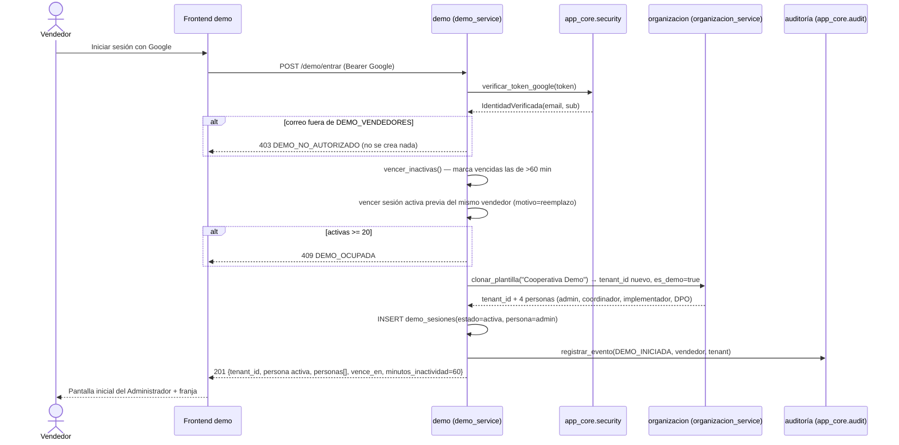
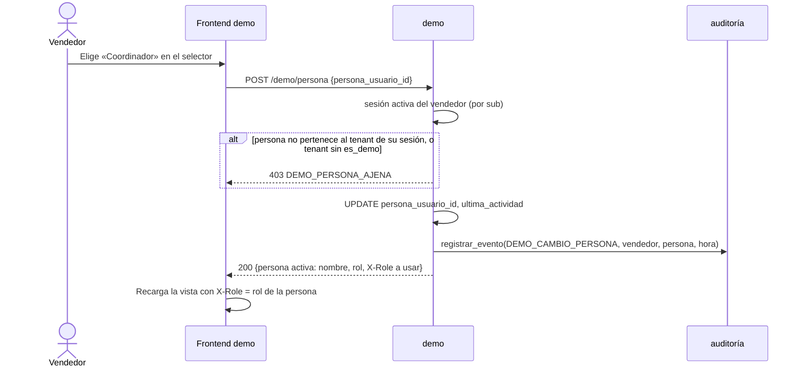
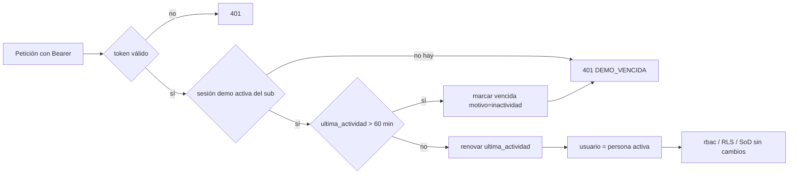
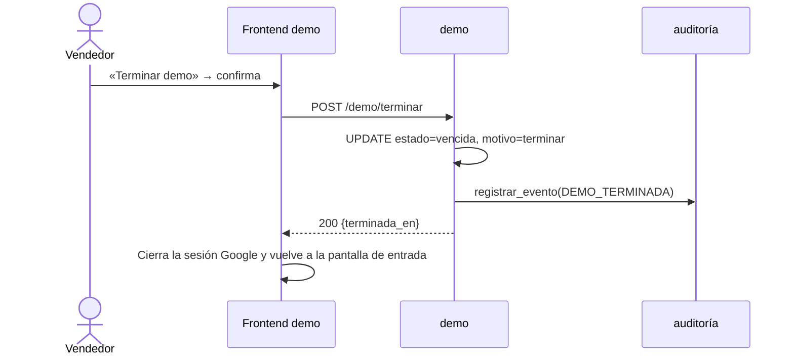
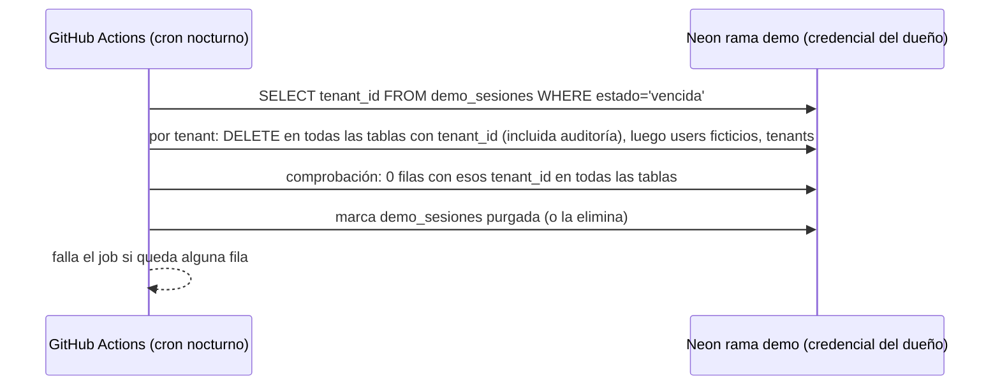
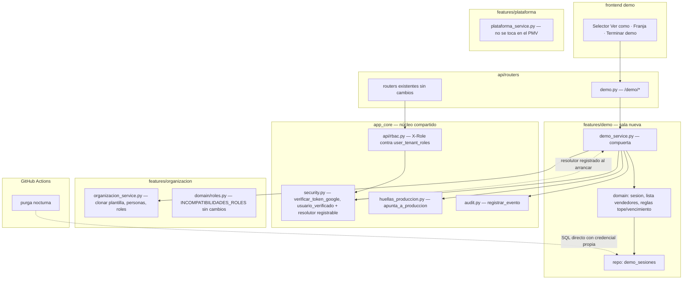

# Demo comercial — flujos funcionales y proyección ADPA

> **Histórico · sustituido por `PRD_EVYDENTIA` §5.6 y `UX_DEMO_EVYDENTIA.md`.** La demo de EVYDENTIA usa una instancia Cloud SQL propia, protegida por SEC-20 con `entorno_marcador='demo'`. Movido por NEON-04 (2026-11-12) con `git mv`.


Arquitecto de soluciones ADPA · 2026-11-06 · Fuentes: PRD §Módulo 9 (`origin/main`), documento del CTO «Demo comercial: requisitos para validación del CTO» (rev. 10), código de `origin/main` (6a7c3a2).

Decisiones aplicadas: rol inicial Administrador · vencimiento 60 min sin actividad · tope 20 demos activas · lista `DEMO_VENDEDORES` en Vercel · `*.vercel.app` · sala nueva `features/demo/` con `demo_service.py` · borrado en dos tiempos (vencimiento lógico en la app, purga nocturna en GitHub Actions).

---

## 0. Hallazgo de arquitectura que condiciona todo el diseño

`app_core/security.py::usuario_de_identidad` **no crea usuarios**: quien no está en `users` recibe 403. Y `roles_activos` lee `user_tenant_roles` del usuario verificado. Por tanto:

- El vendedor **no es un usuario** de la base demo. Su identidad Google vive solo en la tabla propia de la sala demo (`demo_sesiones`).
- En `DEMO_MODE=1`, tras verificar el token Google, la identidad se **traduce** a la persona activa de la sesión demo (un `users.id` ficticio con un solo rol). A partir de ahí `roles_activos`, `X-Role`, RLS, la SoD y el trigger `fn_utr_dpo_sod` funcionan **sin cambios**: el PMV ve a un usuario normal con un rol.
- Punto único de inyección: `usuario_verificado()` en `app_core/security.py` consulta un **resolutor registrado** (inversión de dependencia: `app_core` expone `registrar_resolutor_identidad(fn)`; `features/demo/demo_service.py` lo registra al arrancar solo si `DEMO_MODE=1`). Así `app_core` no importa `features/demo`, y sin `DEMO_MODE` el resolutor no existe (RNF-DEMO-02).
- Esto **es un cambio en `app_core/security.py`** (pequeño, pero en el camino de autenticación). Debe pasar por la revisión de Seguridad (paso 5) y por sus pruebas: con resolutor ausente el comportamiento es idéntico al actual.

Modelo de datos de la sala (propuesta; lo fija la ficha DEMO-00):

| Tabla | Campos clave | Notas |
|---|---|---|
| `demo_sesiones` | `id`, `vendedor_email`, `vendedor_sub`, `tenant_id`, `persona_usuario_id`, `estado` (`activa`/`vencida`), `creada_en`, `ultima_actividad`, `vencida_en`, `motivo` (`terminar`/`inactividad`/`reemplazo`) | Sin RLS por tenant (la lee el resolutor antes de conocer el tenant); solo la toca `demo_service`. `lopdp_app` con SELECT/INSERT/UPDATE, **sin DELETE** |
| `tenants.es_demo` (o `tenants.origen='demo'`) | booleano | La regla «solo en organizaciones marcadas como demo» se comprueba aquí |

---

## 1. Flujo funcional (cinco recorridos y sus errores)

### 1.1 Entrar



Reglas: la lista se compara en minúsculas y con correo verificado por Google. La comprobación de tope y el INSERT van en la misma transacción con bloqueo (`SELECT … FOR UPDATE` o `pg_advisory_xact_lock`) para que dos entradas simultáneas no pasen de 20. Decisión de arquitecto (no contradice el PRD): una nueva entrada del mismo vendedor vence su demo anterior; así un vendedor no ocupa dos cupos. RF-DEMO-02 (dos entradas → dos `tenant_id` distintos) se cumple igual.

### 1.2 «Ver como»



El navegador **solo pide**; el servidor guarda la persona en `demo_sesiones`. En cada petición posterior el resolutor devuelve esa persona; si el frontend manda un `X-Role` distinto del rol de la persona, `api/rbac.py` responde 403 como hoy.

### 1.3 Cada petición normal (renovación de actividad y vencida al entrar)



Renovación: para no escribir en cada petición, se actualiza `ultima_actividad` solo si han pasado ≥ 60 s desde la última renovación.

### 1.4 Terminar demo



Los datos siguen físicamente hasta la purga nocturna, pero la organización ya no se puede abrir y no cuenta para el tope. El texto de la UI no debe prometer «borrado inmediato» (véase §4).

### 1.5 Purga nocturna



La credencial vive solo como secreto del entorno de GitHub (no en Vercel). El script de purga es infraestructura (`scripts/` + workflow), no código de la app; se niega a correr si `apunta_a_produccion(url)` es verdadero. Nunca purga la plantilla (`tenant` plantilla marcado aparte).

### 1.6 Caminos de error

| Caso | HTTP / código | Cuándo | Qué ve el vendedor |
|---|---|---|---|
| Correo no autorizado | 403 `DEMO_NO_AUTORIZADO` | `/demo/entrar`, correo fuera de `DEMO_VENDEDORES` | «No autorizado para la demo» |
| Demo ocupada | 409 `DEMO_OCUPADA` | 20 activas tras vencer las inactivas | «Demo ocupada, intenta en unos minutos» |
| Demo vencida | 401 `DEMO_VENCIDA` | cualquier petición con la sesión vencida (inactividad, terminada o reemplazada) | «Tu demostración terminó» + volver a entrar |
| Persona ajena | 403 `DEMO_PERSONA_AJENA` | `/demo/persona` con persona de otro tenant o tenant no demo | «Esa persona no pertenece a tu demostración» |
| Modo demo apagado | 404 | `/demo/*` sin `DEMO_MODE` | (no hay UI) |
| Arranque contra producción | error de arranque | `DEMO_MODE=1` y `apunta_a_produccion()` | (no arranca) |

---

## 2. Proyección ADPA

### 2.1 Carriles por sala



### 2.2 Qué hace cada sala

| Sala | Papel en la demo | Compuerta | Cambio |
|---|---|---|---|
| `features/demo/` (nueva) | Lista de vendedores, tope, sesión demo, persona activa, vencimiento lógico, eventos de auditoría de la demo, resolutor de identidad | `demo_service.py` (nueva): `entrar`, `cambiar_persona`, `terminar`, `estado`, `resolver_usuario`, `vencer_inactivas` | Nueva |
| `api/routers/demo.py` | Rutas `/demo/*`, montadas solo si `DEMO_MODE=1` | consume `demo_service` | Nueva |
| `features/organizacion/` | Clonar la plantilla «Cooperativa Demo» a un tenant nuevo con sus 4 personas y roles | `organizacion_service.py`: añadir **una** función pública `clonar_organizacion_plantilla(origen, marcar_demo=True)` | Ampliación; `roles.py` y trigger intactos (RNF-DEMO-06) |
| `app_core/security.py` | Verificar Google; punto de inyección del resolutor | API pública existente + `registrar_resolutor_identidad` | Cambio mínimo, revisión de Seguridad |
| `api/rbac.py` | `X-Role` contra `user_tenant_roles` de la persona | — | Sin cambios |
| `app_core/huellas_produccion.py` | Barrera SEC-15 al arrancar con `DEMO_MODE=1` y en el script de purga | `apunta_a_produccion` | Sin cambios |
| `app_core/audit.py` | Eventos `DEMO_INICIADA`, `DEMO_CAMBIO_PERSONA`, `DEMO_TERMINADA`, `DEMO_VENCIDA` | `registrar_evento` | Sin cambios (solo inserción) |
| `features/notificaciones/` | Envío apagado con `DEMO_MODE=1` | su compuerta / bandera de configuración | Bandera, sin lógica nueva |
| `features/plataforma/` | Fuera del PMV (pantalla de vendedores) | — | Sin cambios |
| Plantilla (DEMO-03) | Datos ficticios: semilla/migración de datos en la rama `demo` | — | Datos, no código de sala |

### 2.3 Cruces prohibidos

- `features/demo/**` no importa `features/organizacion/domain|repo|…`: solo `organizacion_service`.
- Ninguna sala importa `features/demo/**`; el único que la conoce es `api/routers/demo.py` y el arranque (registro del resolutor), siempre vía `demo_service`.
- `app_core` no importa `features/demo` (por eso el resolutor se **registra**, no se importa).
- `demo_service` no ejecuta SQL sobre tablas de otras salas (ni `user_tenant_roles`, ni `tenants` salvo a través de `organizacion_service`).
- La app no ejecuta `DELETE` (SEC-10, `INV_LOPDP_AUDIT_LOG_APPEND_ONLY`); solo la purga externa borra.
- El frontend no decide la persona: nunca manda `X-User-ID`; el modo `headers` sigue prohibido en la nube.

### 2.4 Árbitros (pruebas) sugeridos por sala

- demo: entrar no autorizado → 403 y 0 filas nuevas; 21.ª entrada concurrente → 409; persona ajena → 403; vencida por reloj simulado → 401 y estado `vencida`; cada cambio genera evento.
- arranque: `DEMO_MODE=1` + host producción → error; sin `DEMO_MODE` → `/demo/*` 404 y resolutor ausente.
- organización: clon con 4 personas, un rol cada una, correos `.invalid`; pruebas SoD existentes en verde.
- purga: tras ejecutar, 0 filas con el `tenant_id` purgado en todas las tablas con `tenant_id`; plantilla intacta.
- ADPA: linter de imports sin cruces.

---

## 3. Datos que el servidor entrega a la UI

`GET /demo/estado` (y la respuesta de `entrar`):

```json
{
  "demo": true,
  "tenant_id": "…",
  "organizacion": "Cooperativa Demo",
  "persona_activa": {"usuario_id": "…", "nombre": "Ana Pérez (ficticia)", "rol": "administrador", "rol_etiqueta": "Administrador"},
  "personas": [
    {"usuario_id": "…", "nombre": "…", "rol": "administrador", "rol_etiqueta": "Administrador"},
    {"usuario_id": "…", "nombre": "…", "rol": "coordinador", "rol_etiqueta": "Coordinador"},
    {"usuario_id": "…", "nombre": "…", "rol": "implementador", "rol_etiqueta": "Implementador"},
    {"usuario_id": "…", "nombre": "…", "rol": "dpo", "rol_etiqueta": "DPO"}
  ],
  "minutos_inactividad": 60,
  "ultima_actividad": "2026-11-06T15:00:00Z",
  "vence_en": "2026-11-06T16:00:00Z"
}
```

Errores: `{"codigo": "DEMO_NO_AUTORIZADO" | "DEMO_OCUPADA" | "DEMO_VENCIDA" | "DEMO_PERSONA_AJENA", "mensaje": "…"}`. Sin `DEMO_MODE`, `/demo/estado` responde 404 y el frontend no pinta nada de la demo.

---

## 4. Puntos para el CTO — CONFIRMADOS (PRD §9, PR #432, commit 74c769b)

Resolutor aprobado con tres condiciones que debe probar Seguridad: (a) sin `DEMO_MODE=1` no se puede registrar; (b) solo resuelve hacia personas de la organización demo propia de la sesión; (c) la auditoría guarda la persona y el vendedor real. Texto aprobado tras terminar: «La demo se cerró y sus datos se eliminan esta noche». Reemplazo aprobado: máximo un cupo por vendedor.

Planteamiento original:

1. **Texto de la franja y «Terminar demo»**: el documento del CTO dice «se borran» / «borra en el acto»; el PRD §9.3 dice vencimiento lógico + purga nocturna. La UI debe decir «se cierran» (ya no accesibles) y «se eliminan esa noche». Propongo esa redacción salvo indicación contraria.
2. **Cambio en `app_core/security.py`** (resolutor registrable): imprescindible porque el vendedor no es usuario; pide revisión de Seguridad.
3. **Una demo por vendedor**: la nueva entrada vence la anterior (motivo `reemplazo`).
4. **Contador de vencimiento** en la franja: opcional; los datos (`vence_en`) ya los da el servidor.
